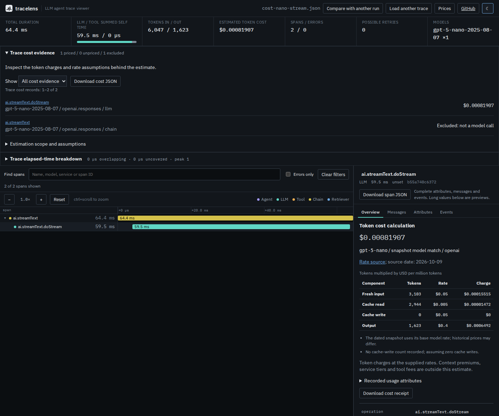
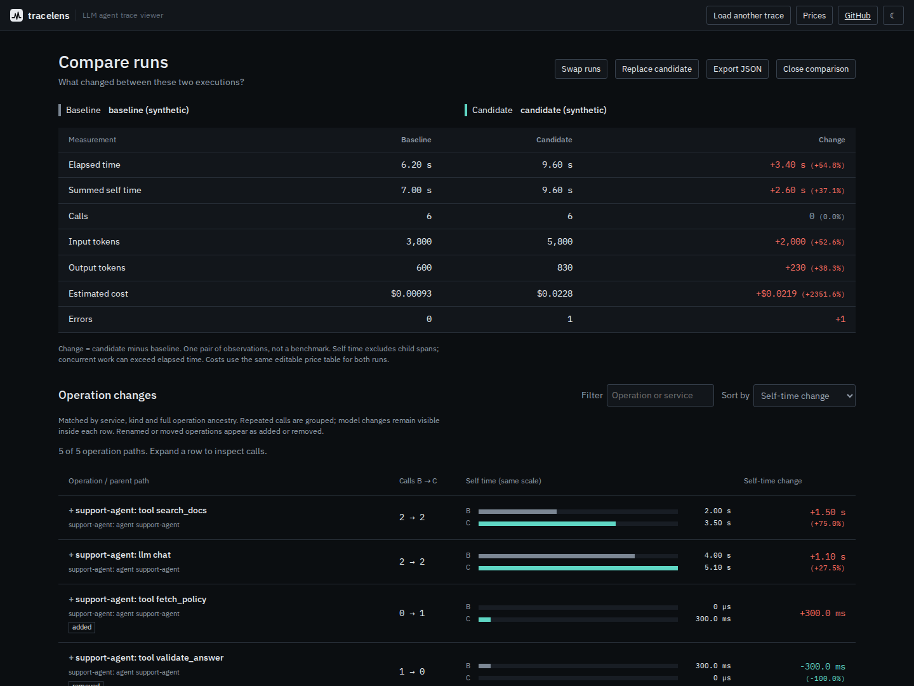
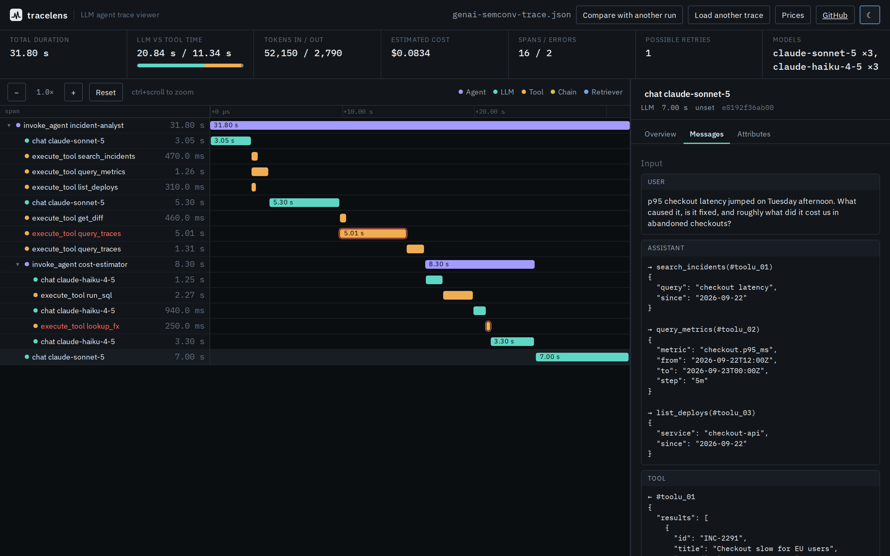
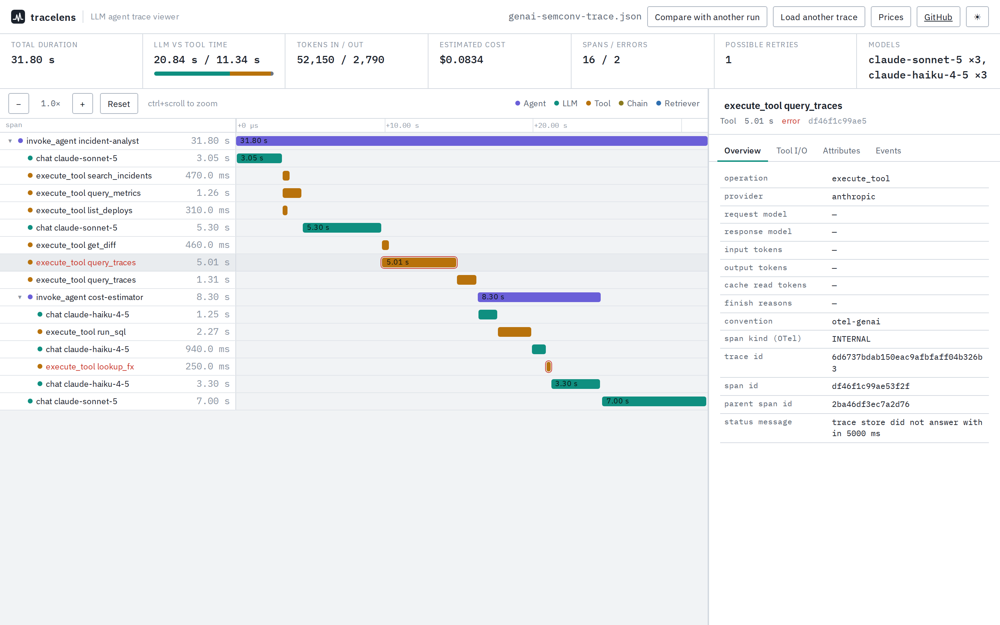
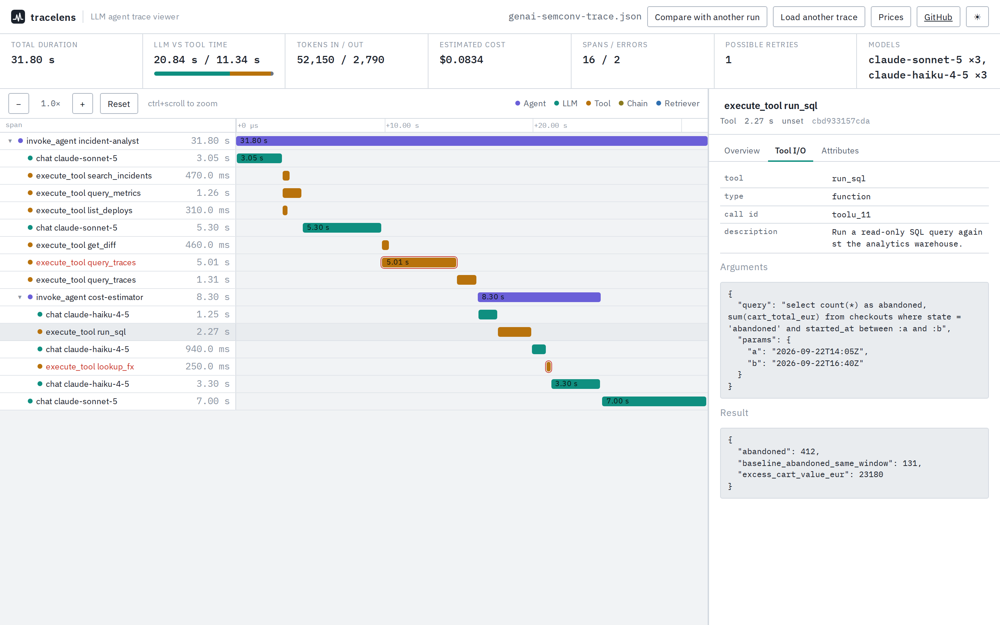
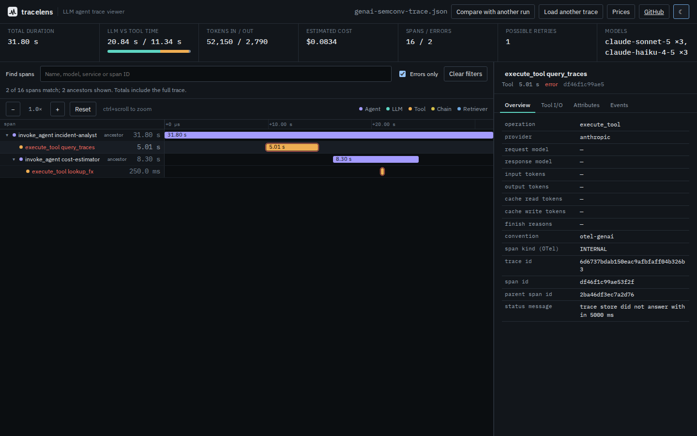
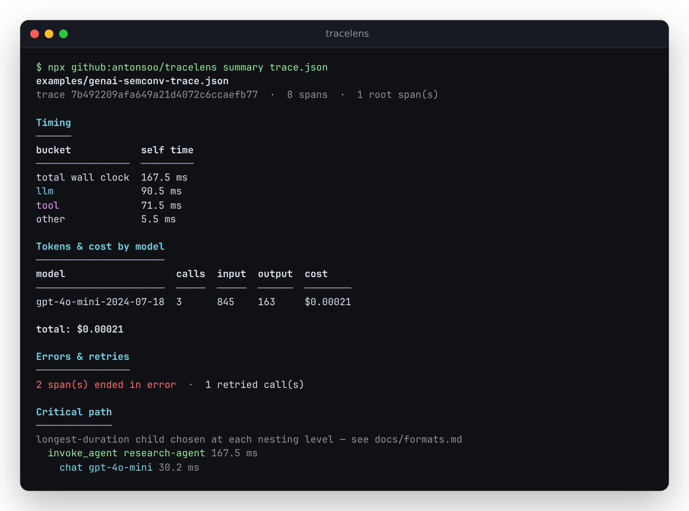

# tracelens

**A zero-install viewer for LLM agent traces.** Drop an OpenTelemetry export,
inspect model calls, tool calls, token usage and estimated cost on a timeline.

[](https://www.npmjs.com/package/@antonsoloviev/tracelens)
[](LICENSE)
[](https://antonsoo.github.io/tracelens/)

Agent frameworks increasingly emit OpenTelemetry traces using the [GenAI
semantic conventions](https://github.com/open-telemetry/semantic-conventions-genai)
(`gen_ai.*` attributes) or Arize's [OpenInference](https://github.com/Arize-ai/openinference)
conventions. Viewing one of these traces today usually means standing up a
server — Jaeger, Langfuse, Phoenix — for a file you could have opened
locally. tracelens is a static, local-first web app plus a small CLI: point
it at an OTLP/JSON trace file (or one downloaded from Jaeger) and get an agent-shaped waterfall, a span
tree, per-span prompts and completions, tool calls, token usage and
estimated cost, errors and retries, and a "where did the time and money go"
summary — nothing leaves the browser tab.



| Question | Workflow |
|---|---|
| What changed between two runs? | [Compare operation paths and inspect their spans](docs/comparison.md), or [open the synthetic comparison](https://antonsoo.github.io/tracelens/?example=compare). |
| Why does summed work exceed elapsed time? | [Inspect overlap, gaps and exclusive intervals](docs/timing.md), with a captured loopback HTTP example. |
| Which calls contributed to the token charge? | [Inspect per-call usage, rates, sources and exported receipts](docs/cost-accounting.md). |
| Why do two token counters disagree? | [Inspect retained aliases and an explicitly unknown charge](studies/usage-conflicts/README.md). |
| Where did queued work or separate messages go? | [Follow span links](docs/span-links.md) and [join related OTLP trace/log exports](studies/log-events/README.md). |

Use the source checkout below for current parsing and accounting behavior.
The [source history](docs/source-history.md) keeps reproduced defects,
before/after evidence and publication boundaries together.

## On real instrumentation output

The example traces here follow the GenAI conventions by hand. The libraries
people install do not all follow them. [A census in this
repository](studies/instrumentation-census/README.md) ran 21 of them (the
OpenTelemetry, OpenLLMetry and OpenInference instrumentations, Pydantic AI,
the Vercel AI SDK) over the recorded provider responses their own test suites
replay, and compared extracted model, usage and tool fields with the recorded response:
1,442 model calls, no model called.

- The released 0.3.3 already showed the provider's model and token counts
  wherever the span held them, and never crashed or mis-nested a span.
- It missed most of what is newer: cache-read tokens in 37 of 86 calls,
  reasoning tokens in 259 of 280, tool calls in 120 of 291. From the Vercel AI
  SDK's `ai.*` spans it showed none of the three.
- The parser correction in that census read those dialects: 85 of 86, 193 of 280, 250
  of 291. The parser was changed to read these same spans, so that is coverage
  of what it was shown, not a prediction for the next library.
- 86 calls have no reasoning tokens in the span at all, and 60 token figures
  differ from the provider's for reasons the census did not separate.

The census's historical cost column reused the old price-matching rule and
did not independently validate rates. [The correction and a separate decimal
cross-check](docs/cost-accounting.md#what-was-wrong) document that limitation.

## Live demo

**[antonsoo.github.io/tracelens](https://antonsoo.github.io/tracelens/)** —
loads the bundled example trace, or drop in your own OTLP/JSON file. Nothing
is uploaded; parsing happens entirely in your browser.

## Quickstart

```bash
git clone https://github.com/antonsoo/tracelens.git
cd tracelens
npm install && npm run build:web   # builds the static site to dist/
npx vite preview                   # serve it locally
```

Or run the CLI without cloning (point it at any OTLP/JSON or Jaeger JSON
trace of your own; `trace.json` below is a placeholder):

```bash
npx @antonsoloviev/tracelens summary trace.json
```

That runs the published package
([`@antonsoloviev/tracelens`](https://www.npmjs.com/package/@antonsoloviev/tracelens)
on npm; the command it installs is `tracelens`).

| Distribution | Scope |
|---|---|
| Source checkout | Current parser, browser and CLI, including `timing`, `cost`, `links` and `logs`. |
| npm 0.3.3 | Published inspection commands; predates those four commands and the current correctness repairs. |
| Live demo | [Verified inspection build](docs/verification-inspection-2026-10-14.md#public-browser-deployment), updated separately from npm. |

## Screenshots





| | |
|---|---|
|  |  |
| Waterfall + span tree, light mode | Tool I/O detail panel |





## Features

- **Native OTLP protobuf (source checkout)** — import SDK HTTP request bodies
  and Collector length-prefixed trace/log files directly, with explicit signal
  and framing. Preserve exact IDs, nanosecond clocks and typed attributes through
  the existing inspection and comparison workflows. Eleven independent wire
  controls include two malformed inputs accepted by the unguarded runtime;
  import checks reject them before producing measurements.
  [Native capture, filenames, browser downloads and limits](studies/otlp-binary/README.md).
  The npm package and public demo have not yet been updated for this addition.
- **OTLP/JSON parser** — resourceSpans → scopeSpans → spans, typed
  `AnyValue` attribute decoding, tree building with graceful handling of
  malformed spans, missing parents and clock skew (see `docs/formats.md`).
  The source checkout also reads Protobuf `MessageToJson` exports directly,
  preserving base64 byte identities and original snake_case attribute names.
  [Actual SDK exports, before/after results and browser downloads](studies/protobuf-identities/README.md)
  check that distinct traces stay distinct and linked spans remain reachable.
- **A collector's file as it is written** — the OpenTelemetry Collector's
  file exporter writes JSON Lines, one export per batch, and every trace
  that passed through it. The lines are read as one export, and a file with
  several traces gets a picker (`--trace <id>` in the CLI), opening on the
  trace with the most spans.
- **Related exports together (source build)** — choose or drop up to 32 files
  (25 MB combined in the browser). Resolve cross-service parents and links before
  selecting a trace; retain source filenames and reject overlapping identities.
  The CLI accepts file groups for inspection and comparison.
  [Captured workflow, commands and limits](studies/multifile/README.md).
  The source build also joins [Jaeger's 64-bit trace ID spelling](studies/jaeger64/README.md)
  to its zero-padded OTLP identity, including parent links and duplicate checks.
- **Jaeger JSON too** — a trace downloaded from the Jaeger UI is converted to
  OTLP (microsecond times, typed tags, span kind and status from their tags,
  logs as events) and gets the same checks.
- **Status evidence (source build)** — quoted integer error codes retain the
  recorded failure. Unreadable or unfamiliar status codes retain their raw
  fields and make error/retry counts unknown; comparisons no longer claim a
  100% error reduction from damaged status data.
  [Native SDK, CLI and offline-browser reproduction](studies/status-evidence/README.md).
- **Two semantic conventions**, read side by side: OpenTelemetry's GenAI
  semconv (`gen_ai.*`, including the legacy per-message-event fallback
  older instrumentation still emits) and OpenInference (`openinference.*`,
  `llm.*`, including its flattened `llm.input_messages.<i>.*` encoding).
  In the source checkout it also reads the dialects real libraries write
  beyond them (the Vercel AI SDK's `ai.*` spans, OpenLLMetry's indexed
  `gen_ai.prompt.N` messages and `llm.request.type`, Strands' event
  content): [what, and how it was measured](studies/instrumentation-census/README.md).
- **Waterfall timeline** — spans colored by kind (agent / LLM / tool /
  chain / retriever / …), zoom via the toolbar or ctrl+scroll, pan by
  dragging once zoomed in. Only the rows in view are rendered, so a trace
  of tens of thousands of spans scrolls and selects like a small one.
- **Collapsible span tree**, merged into the same rows as the waterfall so
  selection and scrolling never fall out of sync between two panes. The
  arrow keys walk it: up and down move, left and right fold and open,
  Home and End jump, Enter selects.
- **Find spans** by name, operation, model, service, kind, provider or span
  ID, with an **Errors only** switch. Words are matched together,
  case-insensitively. Matching spans keep their ancestors visible; the
  count distinguishes matches from context. Clearing filters restores
  folded branches. Filters affect only the waterfall: summary totals and
  comparison exports still cover the whole run. Search stays in memory,
  makes no requests, and does not inspect prompt or tool payloads.
- **Detail panel** — attributes, a pretty-printed message thread (system /
  user / assistant / tool, with tool calls and their results inline), tool
  arguments and results, and span events (exceptions rendered with their
  real captured stack trace).
  Its tabs support Left/Right, Home and End; Tab enters the active panel.
  Attributes and warnings have 50 entries per page; messages, message
  parts and events have 20. Page controls include a direct page number.
  Long values are marked as previews. **Download span JSON** saves the
  selected span's complete decoded attributes, messages, resource and
  events, with exact timestamps and child IDs. This download includes
  captured content; comparison exports still omit it.
- **Recoverable loading** — cancel a pending file read or sample download,
  replace it with another choice, or retry after failure. An invalid
  candidate or trace switch preserves the current comparison. Parsing
  runs in a dedicated worker, including decoding, normalization and trace
  switching. Cancellation stops that worker and its pending reads. Failed
  or timed-out imports preserve the current run or comparison.
  In source, malformed UTF-8 or BOM-marked UTF-16 is rejected before parsing,
  so damaged names cannot silently become identical replacement characters.
  Valid Unicode remains intact. [Byte-level replay and browser recovery](studies/text-integrity/README.md).
- **Summary header** — total duration, LLM time vs. tool time (by *self*
  time, not double-counting nested spans), tokens in/out by model, an
  editable-price cost estimate, error and retry counts. The elapsed-time
  breakdown separates single-span work, overlapping work and uncovered time,
  with exact nanosecond evidence and source inspection.
  Partial imports leave full token/error/retry totals unknown while retaining
  known subtotals. [Native capture and browser controls](studies/cost-coverage/README.md#token-headlines-after-a-partial-import).
- **CLI** (`tracelens summary` / `tracelens tree`) for the same numbers in
  a terminal, e.g. in a CI log. Names taken from the trace are printed
  without their control characters, so a trace cannot send escape sequences
  to the terminal.
- **Token cost receipts** in the checkout: `tracelens cost` and the browser
  show per-call rates, recorded usage, assumptions, and reasons for unpriced
  calls. Embeddings and rerankers remain in coverage; wrapper totals are
  explicitly excluded. Export a price table from **Prices** and use
  `--prices prices.json` with `cost`, `summary` or `compare`.
- **Run comparison**, in the browser and `tracelens compare`: operation
  groups ranked by absolute self-time change, model changes, added/removed
  operations, per-side span inspection, and JSON export with pricing inputs.
  Missing measurements remain unknown; an unpriced call cannot become a
  claim of cost savings.
- **Phone inspection (source build)** keeps the timeline in a bounded scrolling
  panel, with room for its timing track beside the labels. Selected details stay
  near the timeline even for thousands of spans; keyboard navigation and full
  downloads remain available. [Before/after geometry and browser checks](studies/mobile-waterfall/README.md).
- Light and dark themes, zero telemetry. After the app loads, local file
  imports, loaded trace switching and evidence downloads work offline.
  The parser is bundled with the app and runs in cancellable blob workers.
  New sample downloads and a whole-page reload need the host or browser cache.
  The page's
  Content-Security-Policy restricts page scripts and connections to this
  origin. The parser only fetches bundled sample URLs; imported trace
  content is decoded locally and never sent to a service.

## How it works

### Parsing (`src/core/otlp-parser.ts`)

OTLP/JSON's attribute values are a typed union
(`{"stringValue": "..."}`, `{"intValue": "123"}`, `{"arrayValue": {...}}`,
...), not bare JSON — `decodeAnyValue()` decodes all six variants. Spans are
flattened into one array, then linked into a tree by `parentSpanId`; a span
whose parent isn't present in the file becomes a root with a warning
instead of being dropped, and an end time before its start time (clock
skew) is clamped to zero duration rather than propagating a negative number
through every downstream calculation.

### Semantic-convention mapping (`src/core/normalize.ts`)

Both conventions are mapped onto one normalized `GenAiInfo` shape so the UI
never has to branch on "which convention is this." The exact attribute keys
read, with the spec versions and URLs they were checked against, are in
[`docs/formats.md`](docs/formats.md) — including the parts that are easy to
get wrong: `gen_ai.provider.name` vs. the older `gen_ai.system`,
messages-as-a-JSON-string vs. messages-as-structured-attributes (the spec
allows either), and OpenInference's flattened `llm.input_messages.0.message.role`
indexing vs. GenAI's nested-array shape.

### Cost estimation (`src/core/cost.ts`, `src/core/pricing.ts`)

Each default rate retains its source URL and check date. These are price
snapshots, not a live pricing feed. Matching uses whole model names and
recorded providers; a base entry can explicitly permit dated snapshots.
Unlisted variants, ambiguous entries and provider mismatches stay unpriced.
Fresh input, cache reads, cache writes and output each have a visible charge.
Reasoning tokens already included in output are not charged twice.

The **Prices** dialog edits the browser's local table and exports it for the
CLI. `--prices prices.json` replaces the CLI table. Missing cache counts or
rates produce disclosed assumptions; missing required usage stays unknown.
These are token estimates, excluding service tiers, context premiums and
tool fees. [Calculation rules, receipts and a recorded example](docs/cost-accounting.md).

### Critical path (`src/core/critical-path.ts`)

The CLI labels the existing longest-child chain as a heuristic. It reports one
span per nesting level and cannot account for overlapping or sequential siblings.
The new [`timing`](docs/timing.md) command and browser breakdown account for every
recorded interval instead: elapsed time equals summed self time minus overlap
excess plus uncovered time. This is timestamp accounting, not a claim about
causality, CPU use, missing instrumentation or how much faster a change would be.

### Web UI (`src/web/`)

Vite + TypeScript with **no framework**, using DOM components and a small
observable store (`src/web/store.ts`). Trace content (prompts, tool arguments, anything that came
from the dropped file) is rendered through `textContent`/DOM properties
only, never `innerHTML` with interpolated data — see the comment in
`src/web/dom.ts`.

## Usage

### Inspect a token charge (source checkout)

```bash
npm ci
npm run build
node dist-cli/cli/index.js cost examples/cost-nano-stream.json
node dist-cli/cli/index.js cost examples/cost-nano-stream.json --json > cost.json
```

For the browser, run `npm run preview` and choose **Inspect token cost
(recorded SDK replay)**. Expand **Trace cost evidence**, then choose
`ai.streamText.doStream`. Its calculation totals **$0.00081907** at the
cited nano rates. The SDK wrapper repeats the same token counts and is
listed as excluded. [Replay provenance and independent check](scripts/cost-replay/README.md).

### Compare a baseline with a candidate

In the browser, load your baseline and choose **Compare with another run**.
Select the candidate file. Expand an operation to inspect either run's
original calls; use **Back to comparison** to return. **Swap runs** reverses
the comparison, and **Prices** applies the same table to both runs.

To try a reproducible example from the checkout:

```bash
npm ci
npm run build
node dist-cli/cli/index.js compare examples/comparison-baseline.json examples/comparison-candidate.json
```

The example is **hand-authored synthetic telemetry**, with a model change,
a failing search followed by another search, and an added/removed tool:

| Measurement | Baseline | Candidate | Change |
|---|---:|---:|---:|
| Elapsed time | 6.20 s | 9.60 s | +3.40 s |
| Summed self time | 7.00 s | 9.60 s | +2.60 s |
| Input tokens | 3,800 | 5,800 | +2,000 |
| Output tokens | 600 | 830 | +230 |
| Errors | 0 | 1 | +1 |

Search contributes +1.50 s of summed work, and model calls +1.10 s.
The elapsed-time change differs because the baseline's searches overlap
for 0.80 s, while the candidate's searches run sequentially. These are
observations about the example, not a model benchmark or a causal claim.

```bash
node dist-cli/cli/index.js compare examples/comparison-baseline.json examples/comparison-candidate.json --json > comparison.json
```

The versioned JSON includes per-operation measurements, missing-call
counts, original span IDs, model names, parser warnings and the price table
used. `costEvidence` includes each side's token receipts and usage attributes.
It omits prompts, completions, other attributes and tool payloads, but
operation names and IDs may still contain information you do not want to
share. [Matching rules and limitations](docs/comparison.md).

### Inspect one trace

**Export a trace from your own app.** With the OpenTelemetry Collector's
file exporter:

```yaml
exporters:
  file:
    path: ./trace.json
service:
  pipelines:
    traces:
      exporters: [file]
```

That file is JSON Lines: the exporter appends one export per batch, so a
run of any length is several lines, and every trace the collector saw is
in it. tracelens reads it as it is. When it holds more than one trace, the
web app shows a picker above the summary, and the CLI lists the traces with
the flag that reads each:

```
$ tracelens summary trace.json
trace.json
trace 6d6737bdab150eac9afbfaff04b326b3  ·  16 spans  ·  1 root span(s)
3 traces in this file; showing 6d6737bdab150eac9afbfaff04b326b3 (invoke_agent incident-analyst, 16 spans, 31.80 s)
  also: aaaaaaaaaaaaaaaaaaaaaaaaaaaaaaaa (support-agent, 6 spans, 6.20 s)   --trace aaaaaaaa
  also: bbbbbbbbbbbbbbbbbbbbbbbbbbbbbbbb (support-agent, 6 spans, 9.60 s)   --trace bbbbbbbb
...
```

(The file here is the bundled GenAI example in two batches, with the two
synthetic comparison runs between them.)

`tracelens compare runs.json runs.json --baseline-trace aaaaaaaa --candidate-trace bbbbbbbb`
compares two runs out of the same file.

Or straight from the Python SDK, converting `ExportTraceServiceRequest` to
its OTLP/JSON wire form (see `examples/otel_genai_example.py` for a full
working example, including how to encode typed `AnyValue`s by hand when you
don't have a collector in the loop):

```python
from opentelemetry.sdk.trace import TracerProvider
from opentelemetry.sdk.trace.export import BatchSpanProcessor
# ...export via your OTLP exporter of choice, then convert to OTLP/JSON
```

**Open it.** Drag the file onto the [live demo](https://antonsoo.github.io/tracelens/),
or `npx @antonsoloviev/tracelens summary trace.json` for a terminal summary.

## Supported conventions

See [`docs/formats.md`](docs/formats.md) for the complete, cited attribute
list. Summary:

| Convention | Status |
|---|---|
| OTLP/JSON wire format | Supported: one document, or JSON Lines with an export per line (the Collector's file exporter) |
| Protobuf JSON serialization | Source checkout: canonical base64 trace/span IDs and original field names, normalized to the same parsed trace as the hexadecimal OTLP form |
| OpenTelemetry GenAI semconv (`gen_ai.*`) | Supported, including the legacy `gen_ai.system` attribute and per-message-event fallback. Checked on spans written by OpenLLMetry 0.62.4 |
| OpenInference (`openinference.*`, `llm.*`) | Supported: multi-part contents, tool calls and tool results as the instrumentation libraries write them. Checked on spans written by `openinference-instrumentation-anthropic` 3.0.1 and `-openai` 0.1.63 |
| Jaeger native JSON export | Supported: converted to OTLP/JSON, then parsed the same way; a search result with several traces is read one trace at a time |

## Example traces

`examples/genai-semconv-trace.json` and `examples/openinference-trace.json`
are **real [OpenTelemetry Python SDK](https://opentelemetry.io/docs/languages/python/)
output**: real trace/span IDs, parent/child links and captured Python stack
traces on the failing spans. The model and tool calls are **mocked** (this
machine has no LLM API keys), and the GenAI trace's timings are set
explicitly to realistic values; the telemetry format itself is not mocked.
The default example is a 16-span, 31.8-second incident-analysis agent run
with parallel tool calls, a retried timeout, a sub-agent on a cheaper model
and one permanent tool failure. See `examples/README.md` for the full
scenario and how to regenerate them. `examples/jaeger-genai-trace.json` is
the same trace in Jaeger's JSON, written by `scripts/otlp-to-jaeger.mjs`.

## Accuracy and limitations

- The viewer and comparison read **one trace at a time**; an imported file
  or group with several traces is read for the one you pick. Comparison groups by service namespace,
  service name, kind and full operation ancestry; renaming or reparenting
  an operation produces an added/removed group. Repeated calls in a group
  are not individually paired, and a pair of runs does not establish
  statistical significance. See [comparison details](docs/comparison.md).

- The cost estimator is only as good as the supplied price snapshot;
  unlisted models and incompatible or ambiguous rates stay unpriced.
- Incomplete or invalid token counts leave costs unknown. Single-run
  totals label partial costs as subtotals. Cache counts must be included
  in total input; billing details beyond the token price table are not modeled.
  The current importer also validates typed attribute values before normalization:
  empty integers cannot become zero, duplicate attributes cannot select the last
  count, and valid quoted doubles remain numeric. Rejected values stay inspectable.
  [SDK control, altered exports and offline downloads](studies/attribute-values/README.md).
- Malformed resource/scope containers now produce [source-path warnings](studies/export-containers/README.md)
  while readable spans remain available. The number and identity of spans inside
  an unreadable container stay unknown; complete instrumentation cannot be
  inferred from the file.
- Competing camelCase/snake_case trace fields are rejected by the current importer.
  A partitioned native six-span capture previously displayed only its agent root,
  with no model calls or warnings, because the second resource collection was
  ignored. Single spellings remain supported; ambiguous log scalar fields stay
  raw evidence with warnings and unavailable normalized values.
  [CLI and offline browser reproduction](studies/field-aliases/README.md).
- Quantitative comparisons reject observed span-import
  losses, invalid intervals and unresolved or unreadable parent identities.
  A damaged timestamp in a native capture previously appeared as 40.6% fewer
  input tokens; the candidate now fails comparison validation and the browser
  retains its previous result. Partial traces remain individually inspectable.
  [Reproduction, native controls and limits](studies/comparison-coverage/README.md).
- Cost reports preserve retained charges after observed import losses or missing
  parents, but mark the full token estimate unknown. `knownCostUsd` remains a
  subtotal; `estimatedCostUsd` is null and `incompleteInput: true` is present.
  Call counts describe retained spans; the number of missing calls is unknown.
  Optional event warnings and invalid timing alone do not change token charges.
  [Native SDK cost reproduction and scope](studies/cost-coverage/README.md).
- Possible retries are inferred from a new tool call after a failed,
  completed call with the same name and parent. Repetition alone is not a retry.
  Calls with identical start timestamps are evaluated
  together. Conflicting predecessor outcomes leave the count unknown rather
  than letting export order select a failure or success. A clamped failed
  interval also leaves completion unknown, retaining the supplied end in
  `originalEndTimeUnixNano`; valid zero-duration failures remain supported.
  [Native SDK permutations and offline browser evidence](studies/retry-order/README.md).
- "Critical path" is the heuristic described above, not a guarantee of
  optimality under concurrency.
- The browser takes files up to 25 MiB and reads each file whole in a
  worker. Sample downloads have the same limit after HTTP decompression.
  Imports time out after 30 seconds; split larger collector exports first.
- The parser rejects payloads beyond 128 nested objects/arrays, including
  JSON embedded in message and tool attributes. This counts JSON containers,
  including OTLP wrappers, independently of span ancestry. Single-run
  inspection supports deeply nested spans; comparison has a separate
  256-level ancestry limit. Excessive payload depth rejects the import
  instead of silently dropping evidence.
- JSON Lines is read for OTLP only. Jaeger's JSON is one document.
- Phone labels share the width with the timing track; the track still scrolls
  horizontally to inspect its full scale. Very deep trees cap visual indentation
  while retaining actual tree levels and complete span evidence.

## Tests

```bash
npm test
```

The core test suite covers OTLP parsing against the two real example fixtures
(tree structure, parent/child linking, error-span counts) plus hand-built
edge cases (missing parents, clock skew, malformed spans); semconv mapping
for both conventions against the real fixtures; the waterfall's time→pixel
layout math (`nsPerPixel`/`timeToX`/`spanRect`/pan-clamping); the cost
calculator (whole-model/provider matching, cache-token charges, undefined-not-zero
on a miss); and self-time/retry-count/critical-path correctness on the
example trace. Where a check has an independent oracle — the layout math
against hand-computed pixel positions, the cost math against hand-computed
totals — the test does that, rather than asserting against the code's own
output. Comparison adds operation matching, missing-measurement coverage,
structural validation and interval-union checks against an independent
occupancy oracle. `npm run test:cli` checks the built executable;
`npm run test:browser` exercises the real interface after a build.
The [cost replay](scripts/cost-replay/README.md) additionally checks a fresh
SDK export against the upstream response using independent decimal arithmetic.

**Stress coverage.** `tests/otlp-parser.test.ts` checks a generated
20,001-span trace against a 1000 ms parser ceiling. Browser tests exercise
6,000-span timelines and 6,000 levels of ancestry, and verify that a
20,000-attribute span renders only 50 attribute rows per page while its
download retains every value. They also cancel a deliberately busy parser
and exercise worker failures. These are regression guards, not general
latency guarantees; payload shape and the browser still affect performance.

Large GenAI message fields are decoded once and shared by message/finish-reason
extraction. [Controlled import measurements](studies/message-decoding/README.md)
retain native-capture equivalence checks and separate core timing from browser
loading, rendering and file I/O.

## Development

```bash
npm install
npm run dev          # web UI, http://localhost:5173
npm run test          # vitest
npm run lint           # eslint
npm run typecheck      # tsc --noEmit, both tsconfigs
npm run build           # dist/ (web) + dist-cli/ (CLI)
npm run test:cli        # compiled CLI integration
npm run test:browser    # interaction checks; needs Playwright Chromium + Firefox
```

CI runs are disabled for now, so there's no status badge above.
`.github/workflows/ci.yml` defines install, lint, typecheck, core tests, build,
CLI integration and browser interaction checks on push/PR; `.github/workflows/pages.yml` deploys `dist/` to the `gh-pages`
branch. The workflows use the same commands shown above.

## Contributing

See [CONTRIBUTING.md](CONTRIBUTING.md).

## License

[MIT](LICENSE) © 2026 Anton Soloviev

---

<sub>Part of [Officina](https://antonsoo.github.io/officina/), a set of small open-source tools by [Anton Soloviev](https://github.com/antonsoo).</sub>
