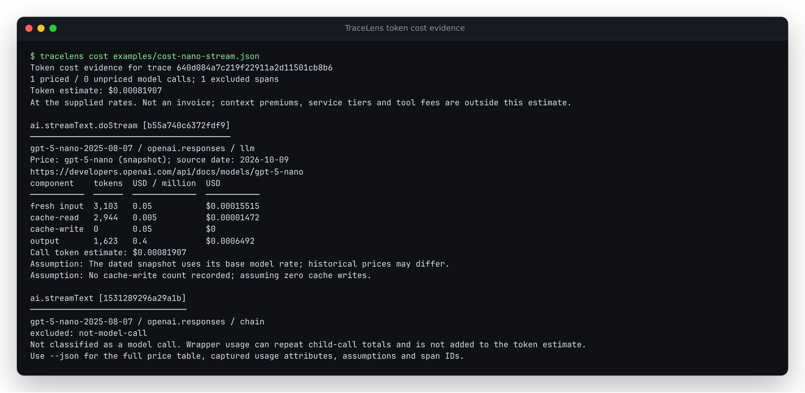

# Inspect the token charge behind a trace

Available in the source checkout; not yet published to npm or the live demo.

TraceLens shows which calls contributed to a token estimate, which could not
be priced, and which wrapper spans were excluded. Each priced call retains
its token components, rate source, source date and assumptions.
[Verification record, package check and screenshots](cost-evidence/verification.md).

## Try the recorded SDK example

From the repository root:

```bash
npm ci
npm run build
node dist-cli/cli/index.js cost examples/cost-nano-stream.json
node dist-cli/cli/index.js cost examples/cost-nano-stream.json --json > cost.json
npm run preview
```



In the preview, choose **Inspect token cost (recorded SDK replay)**, expand
**Trace cost evidence**, and choose `ai.streamText.doStream`. Its receipt
links the calculation to the selected source span. **Recorded usage
attributes** shows the SDK's fields. **Download cost receipt** saves that
call; **Download cost JSON** saves the whole ledger, including hidden pages
and excluded spans. Both work offline after the trace is loaded.


The upstream response names `gpt-5-nano-2025-08-07`. At the
[nano rates](https://developers.openai.com/api/docs/models/gpt-5-nano)
checked on 2026-10-09 UTC:

| Component | Tokens | USD per million | Charge (USD) |
|---|---:|---:|---:|
| Fresh input | 3,103 | 0.05 | 0.00015515 |
| Cache reads | 2,944 | 0.005 | 0.00001472 |
| Cache writes | 0 | 0.05 (input fallback) | 0 |
| Output | 1,623 | 0.40 | 0.00064920 |
| Total | | | 0.00081907 |

The 1,408 reasoning tokens are already inside the 1,623 output tokens. The
SDK's `ai.streamText` wrapper repeats usage from `ai.streamText.doStream`;
it is listed as excluded instead of contributing another charge.

These are token charges at a cited price snapshot. The recorded response
also includes a code-interpreter operation whose separate tool fee is not
included. No provider invoice or historical price at the original request
date was checked. [Replay instructions and independent arithmetic](../scripts/cost-replay/README.md).

## What was wrong

At baseline commit `6ada30f`, the longest substring in a model name selected
the price. The nano variant inherited the base `gpt-5` rate. Providers did
not constrain matches. Embedding calls were absent from cost coverage.

| Recorded case | Before | Current checkout |
|---|---|---|
| Vercel SDK nano stream | $0.02047675, matched `gpt-5` | $0.00081907, matched `gpt-5-nano` |
| OpenLLMetry nano call | $0.00229375, matched `gpt-5` | $0.00009175, matched `gpt-5-nano` |
| LiteLLM embedding without a price | Omitted; zero unpriced calls | One explicitly unpriced call |
| Unlisted `gpt-5-pro`, audio or fine-tuned variant | Could inherit a substring's rate | Unpriced until explicitly configured |

The first two estimates were 25 times the nano token charge at the checked
rates. [Before capture](cost-evidence/before.json),
[fresh SDK capture receipt](cost-evidence/replay.json),
[CLI report](cost-evidence/after.json), and
[independent Decimal result](cost-evidence/decimal-check.json) preserve the
evidence. The new capture uses the same upstream response as the earlier
Vercel fixture, with newly installed, pinned SDK packages and newly emitted
spans. It is not an additional independent provider observation.

The [instrumentation census](../studies/instrumentation-census/README.md)
had a second copy of the unsafe matcher in its scorer. Agreement with it
could verify arithmetic while choosing the wrong product. Its historical
cost columns remain available with a correction; the full study was not
rerun. The new decimal check reads the raw response and explicitly quoted
nano rates, without importing the TraceLens matcher or price table.

## Matching rules

The response model takes precedence. A request model is used only when no
response model was recorded, not when a response model failed to match.
Names and providers are trimmed and compared case-insensitively.

| Input or rule | Decision |
|---|---|
| Whole `matchModel` equals the reported model | Exact match |
| Base name plus a valid `-YYYY-MM-DD` or `-YYYYMMDD` suffix | Snapshot match, unless `matchMode` is `exact` |
| Variant, arbitrary prefix/suffix, fine-tuning ID or deployment alias | Requires its own whole-name entry |
| Recorded provider differs from the rate's provider | Unpriced |
| Rate provider is blank | Explicitly permits any provider; disclosed in receipt |
| Provider is absent from the trace | May use a unique reference rate; disclosed in receipt |
| Exact and snapshot entries both match | Exact model wins |
| Equally specific model entries with known provider | Provider-specific beats blank-provider |
| Several entries remain equally specific | Unpriced; row order does not decide |

Only these endpoint names are treated as equivalent providers:

| Recorded provider | Rate provider |
|---|---|
| `openai.chat`, `openai.responses`, `openai.completion`, `openai.embedding` | `openai` |
| `anthropic.messages` | `anthropic` |

Azure, Bedrock and gateways are not inferred to have the direct provider's
price. A dated snapshot uses its base rate only as a stated assumption; it
does not recover historical pricing. Use an exact entry to override it.

## Supply the same prices to browser and CLI

Open **Prices**, edit and **Save**, then reopen it and choose **Export saved
prices**. The download reflects saved settings, not unsaved form edits.
Editing an entry removes the original vendor citation and records the edit
date. Resetting to defaults restores the bundled price snapshot.

```bash
# prices.json is the saved browser export, moved to this directory.
node dist-cli/cli/index.js cost examples/cost-nano-stream.json --prices prices.json --json
node dist-cli/cli/index.js summary examples/cost-nano-stream.json --prices prices.json
node dist-cli/cli/index.js compare examples/comparison-baseline.json examples/comparison-candidate.json --prices prices.json --json
```

`--prices` replaces the entire table. An empty array intentionally leaves
all model calls unpriced. Malformed CLI tables fail with a readable error;
the CLI does not silently substitute defaults. A row has `id`, `matchModel`,
`provider`, `inputPerMTok`, `outputPerMTok`, `sourceUrl` and `sourceDate`;
`matchMode`, `cacheReadPerMTok` and `cacheWritePerMTok` are optional. Rates
must be finite and nonnegative. Explicit zero rates are valid.

## Reading an export

`tracelens cost --json` exports `format: "tracelens-cost-evidence"` and
`schemaVersion: 1`. `priceTable` is the complete table used. Each `rows`
entry identifies its span, kind, model, provider, normalized usage and
recorded usage attributes. Its `result.status` is:

| Status | Evidence |
|---|---|
| `priced` | Matched entry, exact/snapshot match, component tokens/rates/charges, assumptions |
| `unpriced` | Machine-readable `reason` and a human explanation |
| `excluded` | Non-call span with model/usage evidence, without an added charge |

`knownCostUsd` is the subtotal of priced calls, or `null` when none could be
priced. `estimatedCostUsd` is `null` whenever a model call remains unpriced
or there are no model calls. A calculated zero stays numeric zero. Tiny
positive costs stay visibly nonzero; JSON retains the full floating-point
number. Decimal checks allow for ordinary floating-point roundoff.

Comparison JSON includes these reports in `costEvidence.baseline` and
`.candidate`. Its cost delta stays `null` if either run has unpriced calls.
This does not hide independently known token measurements.

Receipts omit prompts, completions and tool arguments/results. They include
span names, IDs, model names and attributes whose keys begin with
`gen_ai.usage.`, `llm.token_count.` or `ai.usage.`. Those fields can still
contain sensitive data supplied by an exporter; inspect before sharing.

## Limits that remain visible

- Missing LLM input/output usage, invalid counts, contradictory cache
  totals, unmatched providers/models and ambiguous rates stay unpriced.
- Missing optional cache counts are assumed zero. Missing cache rates use
  the input rate. Receipts identify each assumption and fallback rate.
- Embeddings need input usage and a zero output rate. Missing completion
  usage means vector output with no completion-token charge; explicitly
  invalid usage stays invalid. Rerankers need another charging model.
- Rates are snapshots. Context premiums, service tiers, regions, discounts,
  taxes, multimodal tariffs and tool fees are outside this estimator.
- Wrapper spans are excluded by operation kind. Two separate model-call
  spans from overlapping instrumentation can still represent one request;
  cross-instrumentation deduplication is not inferred.
- Skipped or malformed source spans remain parser warnings. A complete
  estimate for the parsed calls does not prove the export contains every
  request in the application.
