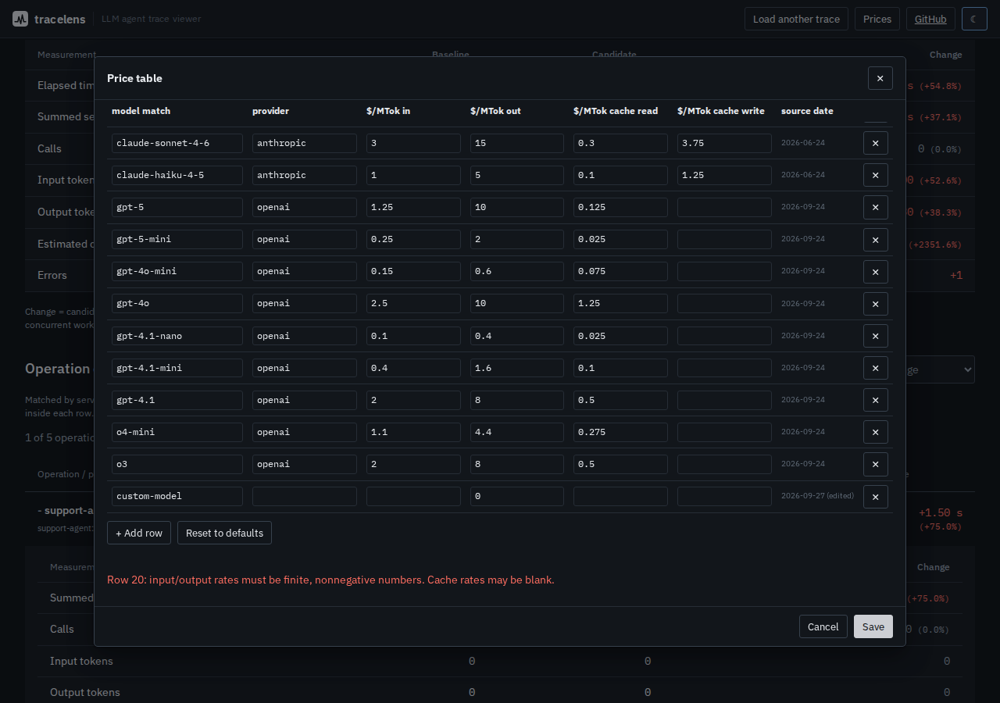
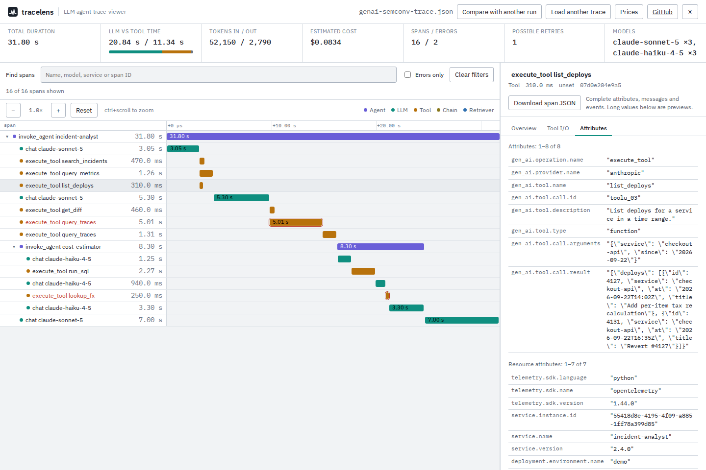

# Supported trace formats

tracelens parses **OTLP/JSON** trace exports (and Jaeger's JSON, converted to
OTLP first) and understands attributes from two independent semantic
conventions layered on top of it. This document
lists the exact attribute keys it reads, the spec versions they were
verified against, and what tracelens does when it sees neither.

The original convention audit below checked the cited files directly on
**2026-09-24**. Both GenAI conventions in particular are marked
"development" upstream and change between checks — re-verify before relying
on this for a new integration.

## 1. Wire format: OTLP/JSON

Source: [`opentelemetry-proto`](https://github.com/open-telemetry/opentelemetry-proto),
`opentelemetry/proto/trace/v1/trace.proto` and
`opentelemetry/proto/common/v1/common.proto` (`main` branch, checked
2026-09-24). This is the shape produced by the OpenTelemetry Collector's
`file`/`otlphttp` JSON exporters, or by `google.protobuf.json_format.MessageToJson`
on an `ExportTraceServiceRequest`.

**Protobuf JSON IDs (source checkout, checked 2026-10-10).** The structures
are shared, but the encodings differ: [OTLP JSON](https://opentelemetry.io/docs/specs/otlp/#json-protobuf-encoding)
uses hexadecimal trace/span IDs, while ordinary [Protobuf JSON](https://protobuf.dev/programming-guides/json/)
serializes bytes as base64. Tracelens converts canonical 16-byte trace IDs and
8-byte span/parent/link IDs to lowercase hex before resolving identities.
Standard and URL-safe base64, with or without padding, are supported; padding
bits must be canonical. Unknown identifier forms retain their spelling and
case. This is a viewer's input decoder, not complete OTLP schema validation.

`MessageToJson(..., preserving_proto_field_name=True)` also writes fields such
as `resource_spans`, `trace_id` and `string_value`. The source parser accepts
those spellings, including nested typed attributes. Exact base64 trace IDs can
be passed to `--trace`; abbreviated selectors use the displayed hexadecimal ID.
The [SDK replay](../studies/protobuf-identities/README.md) checks complete parsed
traces, CLI reports, browser selection and offline navigation across both forms.

```
{ "resourceSpans": [ { "resource": { "attributes": [ AnyValue... ] },
                        "scopeSpans": [ { "scope": {...}, "spans": [ Span... ] } ] } ] }
```

Every attribute value is a **typed `AnyValue`** union, not a bare JSON
value: `{"stringValue": "..."}`, `{"intValue": "123"}` (int64 as a decimal
string), `{"doubleValue": 1.5}`, `{"boolValue": true}`,
`{"arrayValue": {"values": [...]}}`, `{"kvlistValue": {"values": [...]}}`,
or `{"bytesValue": "AQI="}` (retained as base64).
`src/core/otlp-parser.ts` → `decodeAnyValue()` decodes all seven. Parsed `traceId` /
`spanId` / `parentSpanId` byte identities are lowercase hex strings; `startTimeUnixNano` /
`endTimeUnixNano` are decimal-string nanosecond timestamps (parsed as
`bigint` throughout tracelens — see `spanDurationMs()` for the one place
that narrows to a `number`, deliberately, for display). `span.kind` and
`status.code` accept either the numeric proto enum or its `SPAN_KIND_*` /
`STATUS_CODE_*` string name; both are handled.

Bare `{"resourceSpans": [...]}` and a top-level array of `resourceSpans` are
both accepted. Malformed individual spans (missing IDs, an end time before
the start time) are skipped or clamped with a warning rather than aborting
the parse — see `tests/otlp-parser.test.ts` for the exact edge cases.

Exporter-reported `droppedAttributesCount` and `droppedEventsCount` on spans,
and `droppedAttributesCount` on retained events, survive parsing and span
downloads. Positive counts produce warnings scoped to the trace and span;
an empty event list with a positive dropped count is incomplete evidence.
Original snake_case fields are accepted too. Counts accept unsigned 32-bit
integers or Protobuf JSON numeric strings; invalid values remain unknown with
a warning, and null leaves the field unset. Missing or zero counts mean no
reported omissions, not proof that execution was fully instrumented. Resource
and instrumentation-scope attribute omission counts are not yet exposed.
The [SDK limit capture](../studies/dropped-evidence/README.md) verifies the
span/event fields against producer objects before serialization.

A file may be JSON Lines, with an export on each line: that is what the
Collector's `file` exporter writes, a line per batch (see its README, "File
Format"). `parseTraceText()` reads the lines as one export. A last line
that is not complete JSON is skipped with a warning, since a file still
being written ends that way; a broken line anywhere else is an error that
names the line. Lines of metrics, logs or profiles written to the same file
are skipped and counted in a warning.
Line numbers include blank lines in the original file, for LF, CRLF and
CR separators.

The parser accepts at most 128 nested JSON object/array containers,
counting from the document root. JSON embedded in message and tool
attributes is checked separately against the same bound. Exceeding it
rejects the import with an actionable error, before recursive decoding
or serialization can exhaust the stack. This is a payload bound: OTLP
span ancestry is represented by flat IDs and does not consume this budget.

A file may hold several traces, as a collector's file does. Spans are
grouped by trace ID first, because span IDs are only unique within a trace,
and one trace is read: the one named by `ParseOptions.traceId` (a trace ID,
or the start of one that no other trace in the file shares), otherwise the
one with the most spans, the earliest on a tie. `ParsedTrace.traces` lists
them all in order of start time, each with its span count, the name of its
earliest root span, its start and its duration. Within a trace, duplicate
span IDs and cyclic parents are rejected. Missing or invalid span timestamps
are skipped with a warning; they are never silently converted to zero.
Timestamps must fit unsigned 64-bit integers. Numeric JSON timestamps
must also be safe JS integers; use decimal strings for epoch nanoseconds
to preserve precision. This restriction is stricter than a generic OTLP
decoder's numeric acceptance; see the [OTLP JSON encoding specification](https://github.com/open-telemetry/opentelemetry-proto/blob/main/docs/specification.md#json-protobuf-encoding)
(rechecked 2026-09-27).

### Jaeger JSON

A trace downloaded from the Jaeger UI ("Download JSON"), or the query API's
`/api/traces/{id}` response, is read too (`src/core/jaeger.ts`): a
`{"data": [trace]}` document or a bare trace object. Its shape comes from
Jaeger's `model/json` package. A trace is `{traceID, spans, processes}`, and a
span is `{traceID, spanID, operationName, references, startTime, duration, tags,
logs, processID}`. Note the units: `startTime` and `duration` are
**microseconds**, against OTLP's nanoseconds. Each tag is `{key, type, value}`
with `type` one of `string`, `bool`, `int64`, `float64` or `binary`.

tracelens converts the document to OTLP/JSON and then parses it like any other
export, so every check above applies. The mapping:

| Jaeger | OTLP |
|---|---|
| `startTime`, `startTime + duration` (µs) | `startTimeUnixNano`, `endTimeUnixNano` (× 1000) |
| `references`: the first `CHILD_OF`, else the first `FOLLOWS_FROM`, when its trace ID matches | `parentSpanId` |
| All `references`, including the preferred parent | `links`, with `opentracing.ref_type` |
| tag `span.kind` (`client`, `server`, `producer`, `consumer`, `internal`) | `kind` |
| tag `otel.status_code`, or `error: true`; `otel.status_description` | `status` |
| tags `otel.scope.name` / `otel.scope.version` (older: `otel.library.*`) | the instrumentation scope |
| other tags | `attributes`, typed by `type` |
| `logs[]`: the `event` field (else `message`) names it, the other fields are its attributes | `events[]` |
| `processes[processID]` (or an inline `process`): `serviceName` and its tags | the resource: `service.name` plus those tags |

Jaeger has no array or map tags; its OTLP receiver stores them as JSON strings,
and they stay strings here. `examples/jaeger-genai-trace.json` is
`examples/genai-semconv-trace.json` written out by
`scripts/otlp-to-jaeger.mjs`, which shares no code with the reader.
`tests/jaeger.test.ts` checks that both files give the same span tree, times,
status, events and cost.

Jaeger `startTime` and `duration` are both required by this importer. Missing,
negative, fractional, unsafe numeric or out-of-range values skip the affected
span with a warning; an explicit zero duration remains zero. Decimal strings
preserve exact microseconds. Their sum must fit an unsigned 64-bit nanosecond
timestamp. Invalid log times skip the log with a warning, preserving the
remaining events. Failed conversions never fall back to treating raw
microseconds as nanoseconds. [Partial-export reproduction](../studies/import-integrity/README.md).

## 2. OpenTelemetry GenAI semantic conventions (`gen_ai.*`)

Source: [`open-telemetry/semantic-conventions-genai`](https://github.com/open-telemetry/semantic-conventions-genai),
`docs/gen-ai/gen-ai-spans.md` and `docs/gen-ai/gen-ai-events.md` (`main`
branch, checked 2026-09-24). Status: **development** — every attribute below
carries the upstream "development" stability badge, not "stable"; the base
attributes it references (`error.type`, `server.address`/`server.port`) are
from semantic-conventions `v1.44.0` and are stable. This spec superseded and
absorbed the older `gen_ai.*` conventions that used to live in
`open-telemetry/semantic-conventions`; that repo's copy now just redirects
here.

tracelens reads, per span:

| Field | Attribute(s) | Notes |
|---|---|---|
| Operation | `gen_ai.operation.name` | Drives the agent/llm/tool/embedding/retriever/chain classification — see the table in `src/core/normalize.ts` (`GENAI_OP_TO_KIND`). Well-known values: `invoke_agent`, `create_agent`, `chat`, `generate_content`, `text_completion`, `fetch_response`, `embeddings`, `execute_tool`, `retrieval`, `plan`, `invoke_workflow`, `*_memory*`. |
| Provider | `gen_ai.provider.name`, falling back to the older `gen_ai.system` | `gen_ai.system` predates `gen_ai.provider.name` in the spec's evolution and is still what most current instrumentation libraries emit; tracelens accepts either. |
| Models | `gen_ai.request.model`, `gen_ai.response.model` | |
| Agent / conversation | `gen_ai.agent.name`, `gen_ai.conversation.id` | |
| Request params | `gen_ai.request.temperature`, `gen_ai.request.max_tokens` | |
| Token usage | `gen_ai.usage.input_tokens` / `.output_tokens` (falling back to the pre-2024.11 `gen_ai.usage.prompt_tokens` / `.completion_tokens`), `gen_ai.usage.cache_read.input_tokens`, `gen_ai.usage.cache_creation.input_tokens` (also accepted as `.cache_write.input_tokens`), `gen_ai.usage.reasoning.output_tokens`. Also accepted, because real emitters write them: `gen_ai.usage.cache_read_input_tokens` / `.cache_write_input_tokens` / `.cache_creation_input_tokens` (Strands), `gen_ai.usage.reasoning_tokens` (OpenLLMetry), `gen_ai.usage.details.reasoning_tokens` and `.details.thoughts_tokens` (Pydantic AI) | Feeds the cost calculator (§4) and the summary header's token/cost rollup. Per the spec, `input_tokens` includes both cache counts. |
| Finish reasons | `gen_ai.response.finish_reasons`, else the `finish_reason` of each output message | string array |
| Messages | `gen_ai.input.messages`, `gen_ai.output.messages`, `gen_ai.system_instructions` (as attributes, or as the attributes of a `gen_ai.client.inference.operation.details` span event, which is where Strands puts them) | Per spec, an array of `{"role", "parts": [{"type": "text"\|"tool_call"\|"tool_call_response", ...}]}`. Span attributes can't hold nested objects in every exporter, so tracelens accepts this either as a real structured `arrayValue`/`kvlistValue` **or** as a JSON-encoded string attribute (both are legal per spec — "MAY be recorded as a JSON string if structured format is not supported"). |
| Tool calls | `gen_ai.tool.name`, `gen_ai.tool.call.id`, `gen_ai.tool.description`, `gen_ai.tool.type`, `gen_ai.tool.call.arguments`, `gen_ai.tool.call.result` | Arguments/result: same JSON-string-or-structured handling as messages. |
| Errors | `error.type` | Combined with OTel `status.code == STATUS_CODE_ERROR` for the error count and red outline in the waterfall. |

**Legacy per-message events.** Some instrumentation built against the
2023–2024 draft never adopted `gen_ai.input.messages` / `.output.messages`
and instead emits one **span event** per turn: `gen_ai.system.message`,
`gen_ai.user.message`, `gen_ai.assistant.message`, `gen_ai.tool.message`
(each carrying a `content` attribute), and `gen_ai.choice` (carrying
`message`). tracelens falls back to reconstructing a message list from
these events when no `gen_ai.input.messages`/`.output.messages` attribute is
present — see `extractLegacyEventMessages()` in `src/core/normalize.ts`.

**Converse-style content blocks.** Strands writes the content of those legacy
events as a JSON list of blocks (`[{"text": ...}]`,
`[{"toolUse": {"toolUseId", "name", "input"}}]`,
`[{"toolResult": {...}}]`). When every element of the list is such a block,
tracelens shows text parts, tool calls and tool results instead of the raw
JSON; any other content is shown as text, as before. The `finish_reason` of a
`gen_ai.choice` event is read as the finish reason.

**Dialects that are not the convention.** Real instrumentation libraries write
more than the convention names. What tracelens reads beyond it, and where each
was seen (spans from the libraries' own recorded-response tests, see
[`studies/instrumentation-census/`](../studies/instrumentation-census/README.md)):

| Dialect | Seen in | Read |
|---|---|---|
| `llm.request.type` (`chat`, `completion`, `embedding`, `rerank`) | OpenLLMetry Cohere, Mistral | the kind of call, when there is no `gen_ai.operation.name` |
| `gen_ai.prompt.N.role` / `.content`, `gen_ai.completion.N.role` / `.content` / `.finish_reason` / `.tool_calls.M.id` / `.name` / `.arguments` | OpenLLMetry Cohere, Mistral (0.62.4) | the input and output messages, including tool calls; `.content` that is a JSON list of `{"type": "text"}` blocks is shown as text |
| `ai.operationId`, `ai.model.id`, `ai.model.provider`, `ai.response.model`, `ai.response.finishReason`, `ai.usage.inputTokens` / `.outputTokens` / `.cachedInputTokens` / `.reasoningTokens` (and `ai.usage.inputTokenDetails.*`, `ai.usage.outputTokenDetails.*`), `ai.prompt.messages`, `ai.response.text`, `ai.response.toolCalls`, `ai.toolCall.name` / `.id` / `.args` / `.result` | Vercel AI SDK 4-6 `experimental_telemetry`; AI SDK 7 `LegacyOpenTelemetry` | `ai.<fn>.doGenerate` and `.doStream` are model calls, `.doEmbed` embeddings, `ai.toolCall` tools; `ai.generateText`, `ai.streamText` and the other wrapper spans repeat their step totals and are shown as chains, so a call is not counted twice. The spans also carry a few `gen_ai.*` attributes, which take precedence field by field. Convention is shown as `vercel-ai`. |
| `embedding.model_name` | OpenInference embedding spans (OpenAI, LiteLLM, google-genai) | the model of an embedding call, which `llm.model_name` does not name |

## 3. OpenInference conventions (`openinference.*`, `llm.*`)

Source: [`Arize-ai/openinference`](https://github.com/Arize-ai/openinference),
`spec/semantic_conventions.md` (checked 2026-09-24; the spec does not
publish a version number, so tracelens was written against whatever `main`
held on that date).

| Field | Attribute(s) |
|---|---|
| Span kind | `openinference.span.kind` — `AGENT`, `LLM`, `TOOL`, `CHAIN`, `RETRIEVER`, `EMBEDDING`, `RERANKER`, `GUARDRAIL`, `EVALUATOR`, `PROMPT` |
| Model/provider | `llm.model_name`, `llm.response.model_name`, `llm.provider`, `llm.system` |
| Token usage | `llm.token_count.prompt`, `.completion`, `.total`, `.prompt_details.cache_read`, `.prompt_details.cache_write`, `.completion_details.reasoning` |
| Messages | `llm.input_messages.<i>.message.*` and `llm.output_messages.<i>.message.*`: a flattened, indexed encoding (not nested JSON), regrouped by index in `extractOpenInferenceMessages()`. Read per message: `role`; `content` (a plain string); `contents.<j>.message_content.type` / `.text` / `.image.image.url` (multi-part content); `tool_calls.<k>.tool_call.id` / `.function.name` / `.function.arguments` (a JSON string); `contents.<j>.tool_call.*` (the same call listed among the parts: shown once); `tool_call_id` (the message is a tool's result); `function_call_name` / `function_call_arguments_json` (legacy). Falls back to the unstructured `input.value`/`output.value` pair when no indexed messages are present. |
| Request options | `llm.invocation_parameters` (a JSON string: `temperature`, `max_tokens` / `max_completion_tokens` / `max_output_tokens`), `llm.finish_reason` |
| Tool calls | `tool.name`, `tool.description`, `tool.parameters` |
| Session | `session.id` |

The message layout above is what the instrumentation libraries write, not
only what the spec lists: `tests/fixtures/instrumented/openinference.json`
holds spans from `openinference-instrumentation-anthropic` 3.0.1 and
`openinference-instrumentation-openai` 0.1.63, and
`tests/fixtures/instrumented/openllmetry.json` the same two agent turns
from OpenLLMetry 0.62.4 (`gen_ai.*`). `scripts/instrumented-traces/` writes
both by running the real SDKs, instrumented, over a mocked HTTP transport.
The Anthropic instrumentation writes every assistant turn as `contents`
(never `content`) and lists each tool call twice, among the contents and
under `tool_calls`.

## 4. Cost estimation

When both conventions occur on a span, usage is merged field by field;
an explicitly supplied OTel field takes precedence. Invalid supplied
counts remain invalid rather than falling back to another convention.
Without an explicit kind/operation, GenAI model or usage attributes are
treated as evidence of an LLM call; a tool name takes precedence. This is
a legacy-export heuristic, so producers should still supply operation names.

`src/core/pricing.ts` ships a **default price snapshot**, with source URLs
and check dates. The **Prices** dialog edits the browser's local table and
exports it; CLI `--prices` replaces the default table for that invocation.
Matching is case-insensitive against the whole response model (the request
model is used only if the response model is absent). `matchMode: "snapshot"`
is the default and also permits a valid `-YYYY-MM-DD` or `-YYYYMMDD` suffix;
`"exact"` disables that alias. An explicit snapshot entry wins over a base
entry. Variants, fine-tuning IDs and deployment names need their own entries.

Recorded providers must match, except for the documented endpoint aliases
and an explicitly blank provider in a rate row. Missing providers produce
a disclosed reference-rate assumption. Provider-specific entries beat
blank-provider entries at the same model specificity; equally specific
entries remain ambiguous. See the [matching table](cost-accounting.md#matching-rules)
and `findPriceEntry()` in `src/core/cost.ts`.

LLM input and output counts must be safe, nonnegative integers to price
a call. Embeddings may omit output usage because they produce vectors,
but require an explicit zero output rate. Invalid supplied output is not
replaced by zero. Rerankers stay unpriced. Cached reads and writes are included in total input under the
[GenAI span conventions](https://github.com/open-telemetry/semantic-conventions-genai/blob/main/docs/gen-ai/gen-ai-spans.md#inference)
(rechecked 2026-09-27). Fresh input is total input minus both cache counts;
each component uses its own rate, with absent cache rates falling back to
the input rate. Contradictory cache totals, invalid counts and incomplete
usage leave cost unknown. This is a token-based estimate, not an invoice;
multimodal tariffs, discounts and provider-specific billing rules are not
modeled. Providers that report fresh input separately must normalize it
to total input before export. Each receipt shows its rate, token components,
source attributes and assumptions. Non-call wrappers with usage are listed
as excluded; they do not add a second charge. Separate model-call spans
from multiple instrumentation layers are not automatically deduplicated.

Price rules require a nonempty model match and finite, nonnegative rates.
Zero rates are allowed explicitly. Invalid saved tables fall back to the
defaults; an intentionally empty table stays empty. Storage failures do
not prevent inspection or editing for the current session.
Editing a row clears its original source URL and records the edit date,
so the exported table does not attribute custom prices to a vendor.



## 5. Installing the CLI from git

The CLI is on npm as `@antonsoloviev/tracelens`, which is the simple route
(`npx @antonsoloviev/tracelens summary trace.json`). Installing straight from
the repository still works, and this is how:

`npm install`/`npx` on a `github:`/`git+...` spec runs the package's
`prepare` script (here, `tsc` building `dist-cli/`) inside a **project-scoped
install of the cloned repo itself**. npm 12 introduced an `allowScripts`
policy ([npm/rfcs#868](https://github.com/npm/rfcs)) that blocks lifecycle
scripts by default; passing `--allow-scripts` on the command line is
explicitly rejected in that nested, project-scoped context
(`EALLOWSCRIPTS`) — the error message says so and points at
`package.json#allowScripts` instead. `package.json` here declares
`"allowScripts": {"@antonsoloviev/tracelens": true}`, which is read during exactly that
step, so `npx --allow-git=root github:antonsoo/tracelens ...` builds and
runs without the caller needing `--allow-scripts` at all. Verified
end-to-end against a `git+file://` remote: `npm install -g --allow-git=root --prefix <dir> git+file:///path/to/repo.git`
and plain `npx --yes --allow-git=root git+file:///path/to/repo.git summary trace.json`
both produced a working, executable `dist-cli/cli/index.js`.

## 6. Timing and the longest-child heuristic

The `criticalPath` library property is a compatibility-preserved,
cheap heuristic, not a formal scheduling-theory critical path: starting
from the trace's longest root span, repeatedly descend into whichever
**direct child** has the largest duration. See the doc comment on
`computeCriticalPath()` in `src/core/critical-path.ts` for exactly what this
does and doesn't account for (it ignores concurrent/overlapping siblings).
The CLI now labels it **Longest-child chain (heuristic)**. The browser and
`tracelens timing` expose [exact interval accounting](timing.md), including
overlap and gaps, to explain elapsed time.

## 7. Possible retries

The retry count is a heuristic: a tool call follows a failed, completed
call with the same tool name and parent. Successful repeated calls and
overlapping attempts do not count. The trace does not establish that
two calls had identical intent, so the UI labels these **possible retries**.
Calls sharing a start timestamp, including zero-duration calls, do not
establish the temporal order needed for that retry inference.

## 8. Browser inspection and evidence downloads

Each import or trace switch owns a dedicated worker. Cancellation,
replacement, timeout or navigation away from the run terminates it.
The production app embeds its parser and starts blob workers, so switching
among already-loaded traces does not need another script download.
File bytes and downloaded samples are limited to 25 MiB; streamed sample
responses are counted after HTTP decompression. Parsing and normalization
run off the UI thread. The worker returns span-child indices instead of a
recursive tree, so deep ancestry survives structured cloning. The UI
reconnects those indices without changing span order, identity or timestamps.
Summaries, comparisons, graph reconnection and download serialization still
run on the UI thread; this is not a streaming parser.

OTLP links and Jaeger references retain full target identities, attributes,
recorded metadata and omission counts. Targets resolve within the imported
file, including other traces. [Link semantics, resolution and export
details](span-links.md) explain what missing or ambiguous targets mean.

Detail pages show 50 attributes/resource attributes or warnings at a time,
and 20 messages, parts per message or events. Values have bounded previews;
the explicit preview marker is not part of the evidence. Page positions
survive tab, theme and viewport changes while the same span is retained.

**Download span JSON** exports `schemaVersion: 1` and
`format: "tracelens-span-evidence"`, followed by the complete decoded span
fields. Nanosecond `bigint` fields are decimal strings; `children` contains
child span IDs, without copying descendants. `attributes`,
`resourceAttributes`, normalized `genai` fields and events include all decoded
entries retained by the import. Exporter omission counts describe missing
span/event evidence; the download cannot recover what was never exported.
This is decoded evidence, not a byte-for-byte copy of the original OTLP
file, and it includes captured prompts and tool content. Comparison exports
retain their existing content-omitting format. Parser warnings can also
be downloaded without paging or preview limits.



[Dark view](assets/evidence-dark.png), [375px layout](assets/evidence-mobile.png),
and [the last page of 20,000 synthetic attributes](assets/evidence-paging.png).
