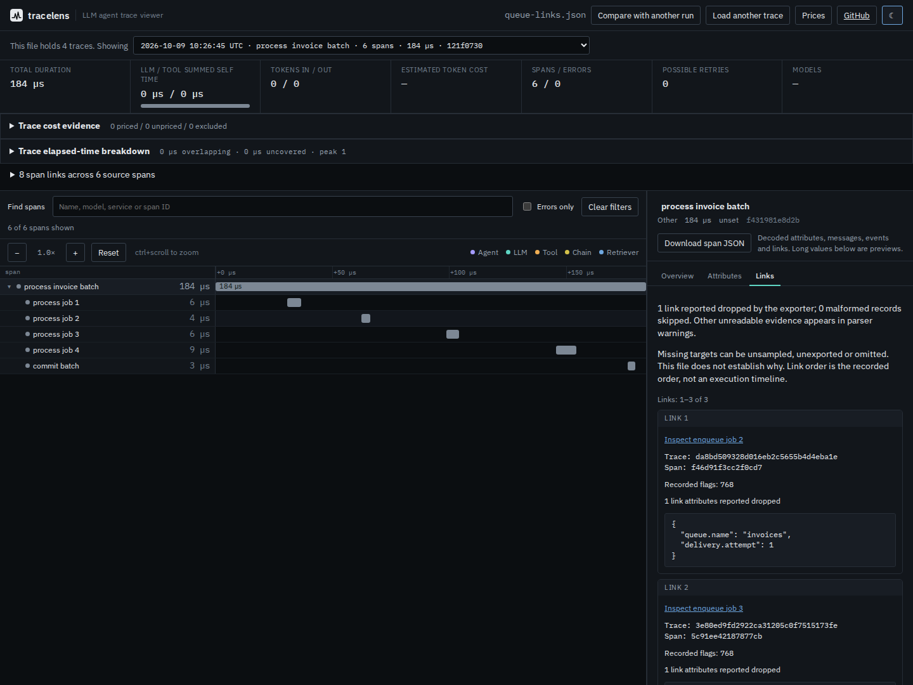

# Following queued work across traces

A batch can consume jobs from several requests. Its parent tree alone cannot
tell you which requests supplied those jobs. OTLP links carry that evidence;
Jaeger references also retain a trace ID and a relationship type.

The current checkout preserves these records. Open **Follow queued jobs
(local SDK capture)**, expand **8 span links**, and inspect **process invoice
batch**. Its Links tab has two producer targets in the file and one absent
target. Choose **Inspect enqueue job 2** to follow a target; **Back to source
span** returns to the batch. Inspecting a linked target from either side of a
comparison leaves both comparison runs unchanged.



From a built checkout:

```sh
npm ci && npm run build
node dist-cli/cli/index.js links examples/queue-links.json
node dist-cli/cli/index.js links examples/queue-links.json --json > links.json
```

`--trace <id-or-unique-prefix>` selects a trace. As with the other commands,
the default is the trace with the most spans. The report covers links **from
that selected trace**, resolving targets across all valid spans in the file.
The CLI prints other trace choices to stderr; JSON stdout is only the report.
The published 0.3.3 package does not contain this command yet.

## What is retained

| Source evidence | Import and inspection |
| --- | --- |
| Link trace ID and span ID | Both are needed to identify a target |
| Link attributes | Decoded typed values, with recorded order and duplicates of links retained |
| Trace state and flags | Preserved when present; flags stay an unsigned integer |
| `droppedAttributesCount` | Exporter-reported omissions on each link |
| `droppedLinksCount` | Exporter-reported omissions on the source span |
| Malformed link record | Skipped with a count and parser warning |
| Invalid collection or counter | Parser warning; no invented count |
| Jaeger references | Each reference becomes a link with `opentracing.ref_type` |

The Links tab pages 20 records at a time. **Download span JSON** includes every
decoded link on that span. **Download links JSON** in the trace's link list
and `tracelens links --json` use the same versioned report, including parser
warnings. These are decoded reports, not byte-for-byte replacements for the
original export; keep that file if you need raw malformed records.

| Target state | Meaning |
| --- | --- |
| Available | Exactly one valid span record has both IDs in this file |
| Missing trace | No valid span from the target trace was imported |
| Missing span | The target trace is present, but this span is absent |
| Ambiguous | More than one record has the target identity; no navigation is offered |

An available record can belong to a malformed parent tree. If that trace
cannot be opened, the browser reports the error and keeps the source view.
No remote tracing service is queried. A missing target could be unsampled,
unexported, filtered, or absent for another reason; the importer cannot tell.
IDs are matched using the parser's existing lowercase string representation;
this feature is not a full OTLP ID conformance validator.

## Parent trees and timing

OTLP links never change parents, timing, token counts or cost. A link is not
proof of waiting time or execution order. Linked targets from other traces
are not folded into the current trace's totals.

Jaeger's native references can supply the parent. Tracelens preserves its
existing preference: the first `CHILD_OF`, otherwise the first
`FOLLOWS_FROM`. That reference is used as a parent **only when its trace ID
matches the current span's trace ID**. A cross-trace reference remains a link,
even if an unrelated local span happens to reuse its span ID. Additional
references are retained as links rather than additional parents. Legacy
`parentSpanID` is used when there is no preferred reference.

The same-trace fallback is consistent with the parent preference in the
[OpenTelemetry OpenTracing compatibility rules](https://opentelemetry.io/docs/specs/otel/compatibility/opentracing/#start-a-new-span).
Those rules describe a shim creating new spans; this viewer imports existing
ones and cannot reassign their trace identities. Native OTLP links follow the
[OTLP Link fields](https://github.com/open-telemetry/opentelemetry-proto/blob/main/opentelemetry/proto/trace/v1/trace.proto)
and [Tracing API link definition](https://opentelemetry.io/docs/specs/otel/trace/api/#link).

## Offline inspection

The production build embeds the parser code in the app and starts it in a
fresh worker for each import. Once the app is loaded, file imports and trace
switches no longer depend on a later download of the worker script. Loaded
samples retain their source text when they contain multiple traces. The
page permits blob workers for this bundled code; trace input is data, never
worker code. The existing connection restrictions still apply.

New sample downloads and reloading the whole site still require the host or
browser cache. Cancellation, timeouts and failures terminate the worker.

## Evidence and limits

[`scripts/capture-links.py`](../scripts/capture-links.py) passes four jobs
through a local Python Queue, propagates their trace contexts, and processes
them in a batch using OpenTelemetry SDK 1.45.1. One producer is unsampled.
The batch deliberately has a three-link limit and a two-attribute limit.
The resulting file has 9 recorded spans across 4 traces, 8 links, and 1
reported dropped link. This is a controlled local workload, not a production
capture or evidence of a messaging system's reliability.

The independent SDK-object oracle revealed **7 trace-state values that the
Python OTLP encoder omitted**. Tracelens cannot recover those values; it
preserves the export as received. Explicit controls cover trace-state fields
that do reach the file. The capture, before/after replay and browser downloads
are documented in [the retained study](../studies/span-links/README.md).
