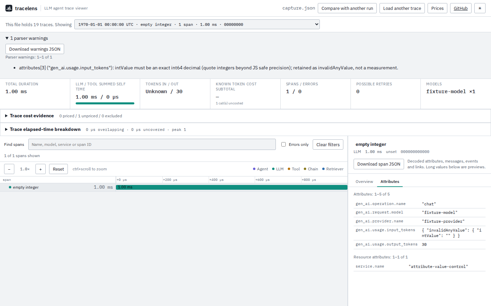

# Typed values must not invent token usage

Baseline source `6d55a07` converted an empty `intValue` to zero, hexadecimal text
to an integer and a sufficiently precise fractional string to a rounded integer.
It also accepted numeric `stringValue` and primitive numeric attributes as token
counts. Each could produce a cost estimate without a parser warning. In the
other direction, valid quoted `doubleValue` numbers remained text and could not
be used as measurements.

The source correction validates before normalizing. Rejected values remain
inspectable as `invalidAnyValue`; duplicate attribute keys retain all original
values as `duplicateAttributeValues`. Neither can become a token count. Span,
event and link warnings stay with their trace/span. Resource warnings stay with
the traces using that resource. Jaeger numeric tags follow the same validation
without first coercing empty text to zero.

This is local, unreleased source work. No hosted demo, repository push or registry
publication is part of this study.

## Evidence and independent checks

[`capture.py`](capture.py) uses OpenTelemetry SDK **1.45.1** and its real exporter
to produce one control span. IDs, timestamps, usage and price rates are fixed
fixture values, not measured production traffic. It explicitly changes that
export to produce 18 further cases. No model is called. The
[oracle](fixtures/oracle.json) records SDK usage before serialization, file
hashes, expected costs from the synthetic rates, and Protobuf **7.36.2** parser
observations for each value.

The [baseline replay](before.json) satisfies **45/76** checks across 19 cases;
the [corrected replay](after.json) satisfies **76/76**. Each case checks input
count, cost availability/value, diagnostic presence and the actual CLI JSON
against the library output. Cost comparisons allow four floating-point epsilons;
these counts describe the controlled cases, not a production failure rate.

| Input attribute | Baseline | Corrected source |
| --- | --- | --- |
| `intValue: ""` or `" "` | 0 input tokens; estimated cost | Unknown; original value and warning |
| `intValue: "0x10"` | 16 input tokens | Unknown; original value and warning |
| `intValue: "1.00000000000000001"` | 1 input token | Unknown; exact decimal is fractional |
| `doubleValue: "1200"` | Unknown usage | 1,200 input tokens |
| `intValue: "0"` | Measured zero | Measured zero |
| Two input-count attributes, 1,200 then 0 | Last value wins | Unknown; both values retained |

The contract references are [Protobuf JSON numeric, null and duplicate-field
rules](https://protobuf.dev/programming-guides/json/) and [OTLP JSON's
deviations](https://opentelemetry.io/docs/specs/otlp/#json-protobuf-encoding),
checked 2026-10-10. Two deliberate limits differ from the Python parser:

- Python accepts the precise fractional string above after float rounding.
  Python `Decimal` independently establishes that it is not an integer. TraceLens
  rejects it under the documented integer-field rule.
- Python accepts an unquoted integer beyond JS safe precision. TraceLens
  preserves it as invalid evidence and requests quoted input; it cannot recover
  the original digits after JSON.parse. Exact large int64 strings remain strings
  and are not treated as safe token measurements.

This is attribute validation, not complete Protobuf conformance. Byte strings
remain encoded without base64 validation; unknown future fields remain ignored.
Duplicate literal JSON keys are outside this check because JSON.parse has
already collapsed them. Diagnostic-free input does not prove complete tracing
or truthful producer measurements. Duplicate key/value entries in OTLP arrays,
and alternate spellings of known AnyValue fields, do remain visible for checking.

## Real application paths

The [Chromium](browser-chromium.json) and [Firefox](browser-firefox.json) records
retain the downloaded span, cost report and warnings for all 19 cases. The built
app imports the file through its worker, goes offline, selects each trace and
exports evidence. Browser costs equal actual CLI output. There were no page
errors or external requests; the inspected view had no axe accessibility
violations.



All four captures were opened and inspected: [Chromium mobile](../../docs/assets/attribute-values/chromium-375.png),
[Firefox desktop](../../docs/assets/attribute-values/firefox-1440.png),
[Firefox mobile](../../docs/assets/attribute-values/firefox-375.png).
The original value and warning remain readable at 375px; long attribute values
wrap, and the existing waterfall scrolls horizontally.

The [existing-corpus comparison](corpus.json) leaves **22/22** file outcomes
unchanged: 27 selected traces and 127 spans, plus rejection of a metadata-only
file. Complete parsed values and warnings are compared, not only counts.

The first decoder draft allocated multiple arrays per value and exceeded the
suite's one-second 20,000-span threshold once. After removing those allocations,
a [separate measurement](performance.json) parsed 20,001 controlled spans with
two attributes each in a median **181 ms**, versus **164 ms** for baseline, over
six timed runs after two warmups on 14-vCPU WSL2 Linux, 48 GB RAM, Node 26.7.0.
This measures parsing, not browser rendering or large attribute payloads.

## Reproduce

```sh
npm ci
npm run build
uv run studies/attribute-values/capture.py --output studies/attribute-values/fixtures
node studies/attribute-values/replay.mjs dist-cli studies/attribute-values/after.json
CAPTURE_ATTRIBUTE_EVIDENCE=1 npx playwright test tests/browser/attribute-values.spec.mjs
```

To replay baseline, make a separate checkout of `6d55a07`, run `npm ci` there,
and pass its `dist-cli` directory as the first replay argument. The baseline
record here comes from a fresh archive/install of that source revision.

```sh
node studies/protobuf-identities/compare-corpus.mjs \
  --before "$BASELINE_DIST" --current dist-cli \
  --output studies/attribute-values/corpus.json
```

The unit checks also cover nested arrays/key-value lists, resource/event/link
warning scope, invalid booleans, integer limits and Jaeger conversion. Full
clean-checkout and installed-artifact verification is recorded separately in
[`checks.json`](checks.json).
