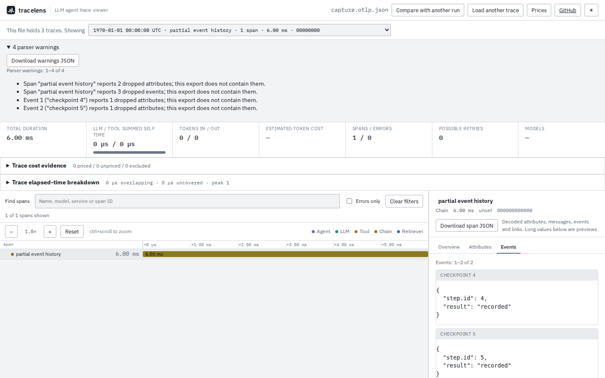

# Exporter limits must remain visible

At `cd114be`, TraceLens discarded the SDK's counts of dropped span attributes,
events and event attributes. An export containing no events looked the same
whether nothing happened or the SDK dropped every event. This change preserves
the counts and emits trace/span-scoped warnings through the browser and CLI.
Span downloads include the counts alongside the retained data.

## Controlled SDK reproduction

[`capture.py`](capture.py) uses OpenTelemetry Python SDK **1.45.1**, its actual
OTLP Protobuf encoder **1.45.1**, and Protobuf **7.36.2**. Each span attempts five
attributes and five events with three attributes apiece. Different `SpanLimits`
produce the omissions below. IDs, epoch-adjacent timestamps and event content
are deliberate fixture values; this is not production traffic or a model call.

| SDK span | Retained events | Dropped events | Dropped span attributes | Dropped attributes per retained event | Warnings before / after |
| --- | ---: | ---: | ---: | --- | --- |
| partial event history | 2 | 3 | 2 | 1, 1 | 0 / 4 |
| all events dropped | 0 | 5 | 0 | none retained | 0 / 1 |
| complete control | 5 | 0 | 0 | 0, 0, 0, 0, 0 | 0 / 0 |

The [oracle](fixtures/oracle.json) reads the SDK objects before serialization.
Files cover hexadecimal OTLP JSON, ordinary base64 Protobuf JSON, and Protobuf
JSON with original snake_case field names. Driver, package versions and fixture
hashes are retained. The contracts are the [trace Protobuf definition](https://github.com/open-telemetry/opentelemetry-proto/blob/main/opentelemetry/proto/trace/v1/trace.proto)
and [Protobuf JSON integer mapping](https://protobuf.dev/programming-guides/json/),
checked 2026-10-10.

## Observations

[`verify.mjs`](verify.mjs) compares counts, original attributes, events and
timestamps against those producer objects. It invokes the actual `summary`,
`tree`, `timing --json`, `cost --json` and `links --json` commands for every trace
and format: 45 CLI executions. [Before](before.json), only the three complete
controls match the SDK omission counts. [After](after.json), all **9/9** match;
all five commands carry the expected warnings. Existing fixture replay keeps
**22/22** file outcomes unchanged, covering **27 traces / 127 spans**; the
[corpus record](corpus.json) includes complete parsed-object hashes, after
excluding only the newly supported counts and positive omission warnings.
This is the checked-in fixture set, not the full instrumentation census.

Chromium and Firefox each import all three formats, switch between all three
traces while offline, and download span and warning evidence. The complete
control remains warning-free after viewing the incomplete traces. Event
details retain the SDK's final two events. An export with all five events
dropped has no Events tab, but its missing-event warning remains available.
[Chromium downloads](browser-chromium.json), [Firefox downloads](browser-firefox.json).



[Chromium at 375px](../../docs/assets/dropped-evidence/chromium-375.png),
[Firefox at 1440px](../../docs/assets/dropped-evidence/firefox-1440.png),
[Firefox at 375px](../../docs/assets/dropped-evidence/firefox-375.png).
All four screenshots were opened and inspected. The narrow warning list
scrolls; the download retains every warning. There is no whole-page horizontal
overflow, and the desktop incomplete-trace view passes the automated axe check.

## Reproduce

From the repository root:

```sh
npm ci
npm run build
node studies/dropped-evidence/verify.mjs
```

Regenerate the SDK fixtures, or exercise the production browser:

```sh
uv run studies/dropped-evidence/capture.py --output studies/dropped-evidence/fixtures
npx playwright test tests/browser/dropped-evidence.spec.mjs
```

Build `cd114be` separately and retain observations of the old parser with:

```sh
node studies/dropped-evidence/verify.mjs /path/to/old/dist-cli /tmp/before.json observe
node studies/dropped-evidence/compare-corpus.mjs \
  --before /path/to/old/dist-cli --current dist-cli --output /tmp/corpus.json
```

## Limits

These are exporter-reported omissions. The viewer cannot recover their
contents, infer unreported drops or detect spans excluded by sampling. Missing
or zero counts mean no reported omissions, not complete instrumentation.
Invalid counts remain unknown with a warning. The change covers span
attributes, events and event attributes; resource and instrumentation-scope
attribute counts remain unsupported. Link omission accounting is separate.

The counts and warnings are source changes; npm **0.3.3** predates them.

[Clean build, installed-package and public-site verification](../../docs/verification-trace-integrity-2026-10-11.md) records the publication boundary and browser investigation.
