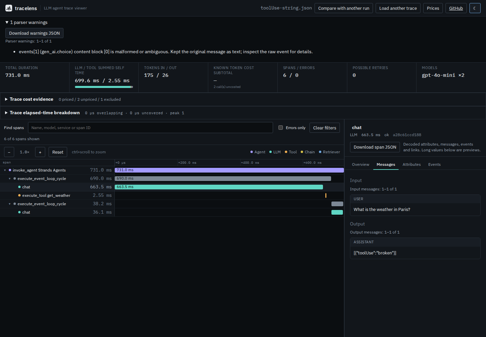
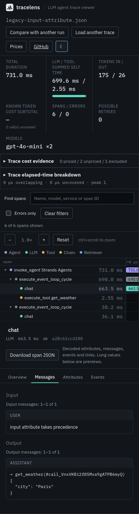

# Keep a damaged message from hiding the rest of a trace

A single malformed nested tool block prevented TraceLens from opening an
otherwise readable six-span Strands trace. A separate fallback bug hid valid
output events whenever the same span had an input-message attribute.

These are controlled mutations of the two retained Strands captures in
[`tests/fixtures/census/`](../../tests/fixtures/census/README.md), not newly
observed production incidents. Strands Agents 1.19.0 emitted the controls
while its upstream test replayed a recorded provider response; no model was
called. The source fixture hashes accompany every case.

## Before and after

The baseline is a fresh archive/install of `3d3343d50b2754ec109db80cdb51dfc8338ab607`.
The correction was built from clean source archive
`194a6d21f39cc394fea182890ff1e1e71c0cde34`.

| Controlled change to a captured span | Baseline | Correction |
| --- | --- | --- |
| `toolUse` or `toolResult` is a truthy primitive | `in` operator TypeError; file fails to open | All six spans open; original message text and one scoped warning |
| Null, array or incomplete tool block | Empty text or anonymous tool call | Original message text and warning |
| Text has a non-string value, or a block has conflicting supported members | Content silently omitted or one member selected | Original message text and warning |
| Damaged block between readable neighbors | Entire trace fails | Entire original message retained, including neighbors |
| Input attribute alongside output event | Output disappears | Attribute input plus event output |
| Output attribute alongside input event | Input disappears | Event input plus attribute output |
| JSON whitespace before readable blocks | Raw JSON instead of tool call | Readable tool call |

The [39-case replay](cases.mjs) contains two unmodified controls, six attribute
precedence variants, 25 damaged/ambiguous content cases, three raw-text
controls, whitespace, explicit null tool input and a readable tool result.
The [baseline](before.json) matches 9 of 39 expected outcomes and rejects eight
files. The [correction](after.json) matches all 39 and rejects none. For every
accepted case the replay checks all six spans, exact raw event strings and
unchanged non-message span fields, timing and cost evidence against its
unmodified control. This is a preservation check, not independent validation
of timing calculations or prices.

Each replay also invokes the actual `summary`, `tree` and `cost --json`
commands on every case: 117 CLI invocations per build. Full stdout is retained
for the legacy control, crashing tool payload and mixed attribute/event case;
other stdout has a SHA-256 receipt. Warnings appear in the terminal and cost
report as well as the parser result. The [existing corpus](corpus.json) has
22 identical complete file outcomes across both builds: 27 trace selections
and 127 spans, plus identical rejection of a metadata-only file. This does not
rerun the full historical instrumentation census.

## Offline browser workflow

The [browser driver](browser.mjs) serves actual build bytes, waits for the
initial page/font load, then disconnects the browser **and stops the server
before importing the first trace**. Each of Chromium and Firefox runs all
39 cases at 1440 and 375 pixels: 156 offline imports per revision. It selects
the captured chat span, opens Messages, downloads span evidence and warnings,
and checks the retained strings and expected message directions. The worker
and UI must complete this with the server gone. Served asset hashes are
compared to the response bodies and retained in the receipts.

[Before](browser-before.json) and [after](browser-after.json) records include
visible message text and representative complete span downloads. Eight file
rejections per baseline context become zero. The damaged export now shows
its text and warning; the hybrid export shows both the attribute input and
its event tool call. Screenshots cover those two cases in both browsers and
viewport sizes under [`docs/assets/event-messages/`](../../docs/assets/event-messages/).

The same workflow exposed delayed font loads: both browsers requested two
monospace files only after the first offline import, producing eight failed
requests across the four baseline contexts. Startup now explicitly loads the
bundled faces. The font files are unchanged; loading all 21 font resources
moves 315,324 source font bytes into initial load. This is additional startup
traffic, not a reduction in download size. Browser receipts record the loaded
faces, actual served assets and any later requests. `document.fonts.ready`
alone does not preload fonts unused by the landing page; the startup code
calls [`FontFace.load()`](https://drafts.csswg.org/css-font-loading/#font-face-load)
for each bundled face.

All 39 declared faces are loaded before disconnecting in the corrected build.
Its four contexts record zero later HTTP requests, failed loads, console/page
errors, external requests and CSP violations. The two pictured states pass axe
in every context and have no page overflow. All 16 before/after screenshots
were opened and inspected; warning text and tool arguments remain readable at
375 pixels. The timeline keeps its existing horizontal scroll area.





## Scope and limits

- Legacy content-block parsing is a heuristic for Strands' JSON-string
  messages. [Supported shapes and precedence](../../docs/formats.md)
  are documented in `docs/formats.md`; these guards are not complete Bedrock
  schema validation. Unknown formats remain raw text. They are not inferred
  to be valid tool calls.
- One warning identifies the first malformed supported block in an event.
  The whole message is preserved rather than partially rebuilding it.
  Existing depth limits still reject excessive nesting; malformed message
  recovery does not bypass that resource bound.
- Attributes win within their own direction; event lists are not concatenated
  with them or reconciled across conflicting representations. Raw attributes
  and events remain available for inspection.
- This is a source update. It does not publish an npm release, tag or hosted
  build. All browser results here use the recorded local builds.

## Reproduce

```sh
npm ci
npm run build
node studies/event-messages/replay.mjs dist-cli /tmp/event-after.json /tmp/event-cases
node studies/event-messages/browser.mjs . /tmp/event-browser.json /tmp/event-images
```

For baseline, archive `3d3343d`, install and build it separately, then run the
same drivers from this checkout with that build directory and `--baseline`.
The replay takes its `dist-cli` path; the browser takes the checkout path.
Use a separate output path for each run. Chromium and Firefox must already
be installed for Playwright. The driver does not download browsers.

```sh
node studies/protobuf-identities/compare-corpus.mjs \
  --before "$BASELINE_DIST" --current dist-cli --output /tmp/event-corpus.json
```

[`checks.json`](checks.json) records the clean-archive checks, installed
artifact replay and file hashes. The targeted unit checks also exercise
trace-scoped diagnostics and rejection of excessive nested JSON.

The clean archive passes lint, both TypeScript projects, build, 30 CLI checks,
the browser interaction/audit driver and all 120 Chromium/Firefox tests.
The default `npm test` run passes 360 checks but exceeds the existing 1000 ms
20,001-span threshold once at 1354.87 ms. All 361 checks pass with
`npm test -- --maxWorkers=2`, without changing the threshold. A separate
[alternating baseline/current measurement](performance.json) gives medians of
157.88 ms before and 148.17 ms after, across six timed runs after two warmups
on 14-vCPU WSL2 Linux, 48 GB RAM. This does not establish general latency or a
speedup; it gives no evidence of a parser slowdown in this workload.

The packed artifact is installed separately and replays all 39 cases plus
117 CLI invocations on each of Node 20.0.0 and 24.21.0. The complete results
equal the clean build, excluding the recorded Node version. All 26 installed
JavaScript/declaration files match the build, and 156 build/check inputs match
the source checkout. The README cost/comparison examples and installed
`npx --offline @antonsoloviev/tracelens summary trace.json` command also run
successfully; its bare installed executable works on Node 20.
