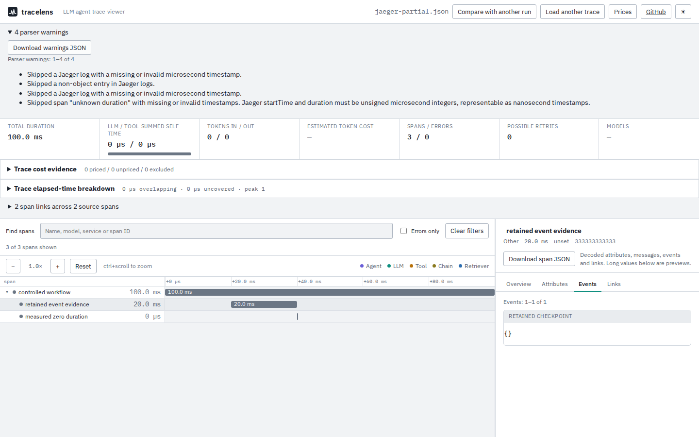

# Unknown timing must not become measured zero

At `785163c`, a Jaeger span without `duration` was imported as a zero-duration
operation without warning. A negative, fractional or textual duration caused
the converter to use the raw microsecond start as the nanosecond end. The
parser then diagnosed clock skew and clamped the operation to zero duration.
An oversized start such as `"100000000000000000"` could instead become a valid
nanosecond date after its microsecond conversion failed.

The converter now leaves failed span conversions absent, allowing the parser
to skip those spans with scoped warnings. Jaeger logs with missing or invalid
times are skipped with their own warnings. Explicit zero durations and log
timestamps remain valid. Non-object OTLP event entries no longer become empty
events at epoch; object events still honor Protobuf's default zero timestamp.
Malformed event collections warn rather than looking like an ordinary empty
list. Missing/null collections remain accepted as empty.

| Input | Previous result | Current result |
| --- | --- | --- |
| Jaeger duration absent or null | Measured zero, no warning | Span skipped, missing/invalid timing warning |
| Jaeger duration negative, fractional or text | Measured zero, clock-skew warning | Span skipped, invalid timing warning |
| Jaeger start outside supported nanosecond range | Raw microseconds sometimes read as nanoseconds | Span skipped |
| Jaeger log timestamp missing or oversized | Epoch or wrong-unit event | Log skipped with warning |
| Jaeger duration or log timestamp explicitly zero | Zero | Zero |
| OTLP event `null`, `false` or `[]` | Empty event at epoch | Record skipped with warning |

The [Jaeger UI model](https://github.com/jaegertracing/jaeger/blob/main/internal/uimodel/model.go)
defines `startTime`, `duration` and log `timestamp` as unsigned integer
microseconds (checked 2026-10-10). The viewer additionally requires resulting
timestamps to fit OTLP's unsigned 64-bit nanoseconds. Numeric input must be a
safe JavaScript integer; decimal strings retain exact values beyond that.

## Reproduction

[`verify.mjs`](verify.mjs) creates fourteen controlled damaged/zero-value
variants of the checked-in **synthetic** Jaeger example. It checks target-span
presence and event timestamps, preserves the other spans' decoded source
fields, and verifies warnings. Parent/child and link resolution may change
when a span is skipped, so those derived relationships are excluded from the
unchanged-source assertion.

The [before record](before.json) matches expected retention/timestamps in
**5/14** cases; the [after record](after.json) matches **14/14** and passes the
warning assertions. One old retention match silently discarded non-object
logs without warnings, so the retention count alone is not full correctness.
This controlled set is not a production failure rate or a Jaeger server replay.

```sh
npm ci
npm run build
node studies/import-integrity/verify.mjs
```

To observe the original behavior, build `785163c` separately and run:

```sh
node studies/import-integrity/verify.mjs /path/to/old/dist-cli /tmp/before.json observe
npx playwright test tests/browser/import-integrity.spec.mjs
```

[`jaeger-partial.json`](jaeger-partial.json) is a small, explicitly synthetic
browser control: four exported spans, one missing duration, one measured zero,
and a span with one valid log plus three malformed logs. The browser retains
three spans and the valid event, with four downloadable warnings. Chromium
and Firefox exercise import, offline event/span downloads, warning downloads
and the measured-zero span. [Chromium evidence](browser-chromium.json),
[Firefox evidence](browser-firefox.json).



[375px view](../../docs/assets/import-integrity/jaeger-375.png).
Both screenshots were opened and inspected. Warnings and event data remain
readable, with the warning list scrolling independently on narrow screens.

These changes do not repair damaged exports or recover skipped contents.
Parser warnings must accompany timing conclusions from a partial file.
An entirely untimed file is rejected. The source change is unreleased on npm;
the registry package remains 0.3.3.

[Clean build, installed-package and public-site verification](../../docs/verification-trace-integrity-2026-10-11.md) records the publication boundary and browser investigation.
