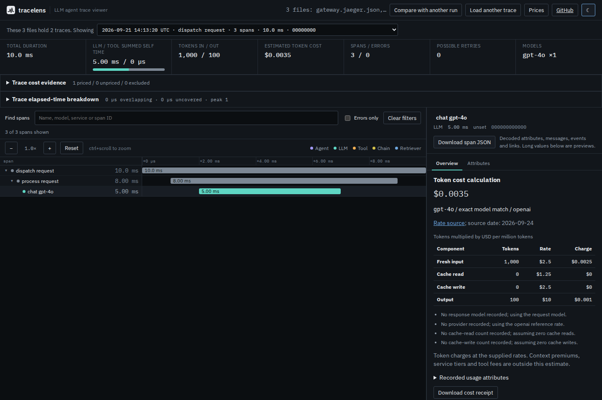

# One request across Jaeger and OTLP exports

A gateway export from Jaeger and a worker export from OpenTelemetry can identify
the same request using different strings. Jaeger's
[TraceID.String implementation](https://github.com/jaegertracing/jaeger-idl/blob/v0.9.0/model/v1/ids.go#L37-L42)
prints sixteen hex digits when the high 64 bits are zero. Its
[query/UI converter](https://github.com/jaegertracing/jaeger/blob/v1.76.0/internal/uimodel/converter/v1/json/from_domain.go#L56-L90)
uses that representation for spans and references. OTLP carries the complete
16-byte identity. Both spellings below describe the same bytes:

| Export | Trace ID |
| --- | --- |
| Jaeger UI/query JSON | `1234567890abcdef` |
| OTLP JSON | `00000000000000001234567890abcdef` |

The [upstream evidence receipt](upstream-encoding.json) records fetched source
hashes and the 16-hex IDs in Jaeger's own query/UI conversion fixture.

At `cd156221`, TraceLens grouped these as different traces. The source fix pads
complete 16-hex trace IDs before any grouping, parent resolution, link lookup,
selection or duplicate checks. It does not truncate a 128-bit identity.



## Retained reproduction

The four small [fixtures](fixtures/) are synthetic, with explicit timestamps,
IDs and token counts. They are not a production capture or a run of Jaeger.
The upstream encoders above establish the representation; an independently
written all-OTLP gateway is the control for the mixed import.

```
dispatch request        gateway.jaeger.json
  process request       worker.otlp.json
    chat gpt-4o         worker.otlp.json

receipt                 audit.otlp.json (a separate trace)
  links to gateway and worker spans
```

| Observation | Before | After |
| --- | --- | --- |
| Traces in the three-file group | 3 | 2 |
| Request spans shown by default | 2 | 3 |
| Request elapsed time | 8 ms | 10 ms |
| Audit link to gateway | Missing span | Available |
| Gateway re-exported in OTLP | Accepted as a separate trace | Duplicate rejected |
| Replay checks matching expected behavior | 1/17 | 17/17 |

[`replay.mjs`](replay.mjs) checks both file orders, all four complete selector
spellings, same-document references and aliases, nonzero-high-word separation,
and real CLI summary/tree/timing/cost/links commands. Summary content is compared
after its filename header; tree, timing and cost stdout match the canonical
control byte-for-byte. Raw observations and fixture hashes are retained in
[`before.json`](before.json) and [`after.json`](after.json).

From this source revision:

```sh
npm ci
npm run build
node dist-cli/cli/index.js tree studies/jaeger64/fixtures/gateway.jaeger.json studies/jaeger64/fixtures/worker.otlp.json studies/jaeger64/fixtures/audit.otlp.json
```

Repeat the observations with:

```sh
node studies/jaeger64/replay.mjs --output /tmp/tracelens-jaeger64.json --expect-fixed
node studies/jaeger64/browser.mjs --build dist --output /tmp/tracelens-jaeger64-browser --after
```

[`browser-before.json`](browser-before.json) and
[`browser-after.json`](browser-after.json) retain Chromium and Firefox workflows
at 1440px dark and 375px light. Each checks the bytes of 24 served assets and
stops the server before importing. The repaired workflows download the selected
span and audit links, follow the gateway link by keyboard, compare with the
all-OTLP control, and reject a duplicate candidate while preserving the previous
comparison. All four completed with no page/CSP errors, external or late network
requests, page overflow, or settled-state axe violations. The screenshots were
visually inspected; the mobile waterfall scrolls within its pane.

## Clean archive and installed package

The [verification receipt](verification.json) covers implementation `3de85f9`.
A fresh archive kept all 496 tracked files unchanged. Node 24.21.0 completed
installation, lint, types, 385 core checks in each of two locales, the web/CLI
build, and 30 CLI checks. The earlier captured SDK multifile replay also passed.
All 33 web-build files matched the build used in the offline workflows.

The broader browser suite passed 127 checks and encountered one Firefox target
crash during an existing trace-switch cancellation check. Five isolated repeats
of that unchanged check then passed. The [failure and retry log](browser-retry.txt)
is retained. The cause was not established; its 32-hex IDs do not enter the
changed normalization branch. No timeout, assertion or runtime code was changed
to obtain the retry results. This was not a clean 128-check first run.

The 52,873-byte local npm tarball has SHA-256
`e83e78781b372f313b51cad051d580a8620142d35b1ab5c8890ed328ba070598`.
Installed with lifecycle scripts disabled, all 26 compiled runtime files matched
the clean build. The [Node 20.0.0](installed-node20.json) and
[Node 24.21.0](installed-node24.json) installed replays each passed all 17 checks;
their retained reports were identical apart from the Node version. CLI version
commands also succeeded. The artifact remains local, with version 0.3.3.

## Identity boundaries

Only complete 16-character hexadecimal trace IDs get this compatibility
normalization. Span IDs already occupy eight bytes and are unchanged. Other
short or opaque labels keep their previous handling. Nonzero high words identify
different traces. A complete 64-bit selector wins over a coincidentally matching
128-bit prefix; the complete 128-bit selector remains available.

Identical exported spans are still rejected as duplicates, with both source
files identified. This repair neither deduplicates retransmissions nor merges
unrelated traces by names or timestamps. An accepted import does not prove that
the exporter recorded every span. Canonical trace IDs in reports from older
64-bit Jaeger exports now have 32 hex characters.

The package version remains 0.3.3. This source change does not update the npm
release or hosted demo.


## Identity labels

The picker at `66890ce` abbreviates every trace with its first eight characters.
For a canonicalized 64-bit Jaeger trace those are always `00000000`. Two traces
with matching names, clocks and counts therefore have identical options.
The detail header similarly shows only twelve leading zeroes for counter-like
span IDs such as `0000000000000001` and `0000000000000002`.

The label now starts with the complete significant sixteen-character trace ID
when its high 64 bits are zero. Other longer trace IDs have a marked prefix
preview. The complete canonical ID remains the option value and is available
in its tooltip. Comparison names use the same label, and the detail header
shows all sixteen characters of a standard span ID. This changes display text;
canonical identities, grouping, timing and exported evidence are unchanged.

[`id-labels.mjs`](id-labels.mjs) constructs two traces from the explicitly
synthetic gateway fixture above. Their names, clocks and measurements match;
only their complete trace and span IDs differ. This is a UI control, not a
native Jaeger capture. The [public before receipt](id-labels-before.json) and
[local after receipt](id-labels-after.json) cover Chromium and Firefox at
1440px dark and 375px light. Both options and comparison names now distinguish
the traces. Actual offline span downloads retain byte-identical identities
and complete payload hashes before and after. Each run reports no page errors,
horizontal page overflow or settled comparison accessibility violations.

All eight [trace/detail and comparison screenshots](../../docs/assets/jaeger64-labels/)
were opened and inspected. The sixteen-character trace label remains visible
at phone width; comparison names wrap within their columns. This does not
claim that arbitrary longer IDs with a shared prefix get unique preview text;
the canonical selection values and full standard-ID tooltips remain distinct.

```sh
node studies/jaeger64/id-labels.mjs https://antonsoo.github.io/tracelens/ /tmp/jaeger-labels after
```

The label correction is verified locally at capture time. Its clean-build and
public delivery receipts follow separately; npm metadata remains 0.3.3.


The [fresh Node 24 archive receipt](id-labels-build.json) covers `80d9c72`.
Fresh installation, lint, types and production builds pass; all 36 web files
match the inspected local build. All 39 compiled CLI/core files are identical
to the prior width-validated archive, and all 32 CLI integrations pass.
The initial default-concurrency unit run passes 613 checks and exceeds the
unchanged one-second 20,000-span deadline once (1,200.76 ms). With two workers,
all 614 checks pass without changing assertions or runtime code. This is not
a claim of an entirely clean first default-concurrency run.


Source `80d9c72` and verification `3238fda` are public. Deployment `dc964f8`
[serves all 36 clean build files exactly](id-labels-hosted-bytes.json), and
[all 25 prior immutable asset URLs](id-labels-assets.json) retain their original
bytes. The [public browser replay](id-labels-hosted.json) agrees with the local
observations in every engine/width context: distinct picker and comparison
labels, complete visible span IDs and eight actual offline downloads with
unchanged payload hashes. No npm registry release accompanies this correction.
