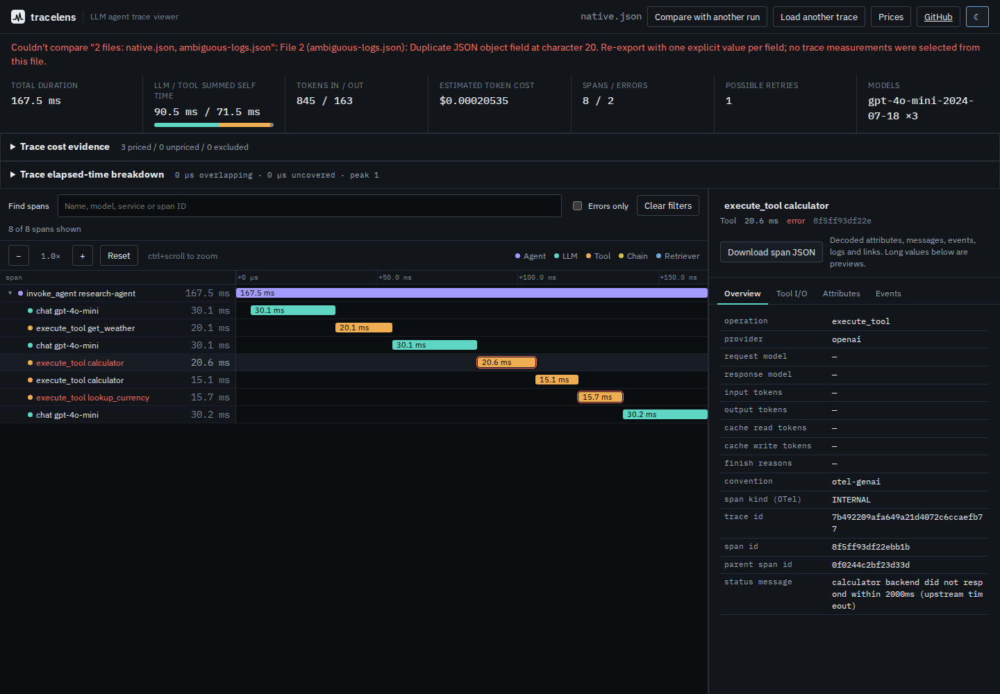

# Repeated JSON fields must not select the evidence

Baseline: `5846310a9052c82b7f3b521c0a349488fa6341c3`. Captured 2026-10-15.

The text importer previously used `JSON.parse()` directly. Repeating
`status.code` in a retained eight-span SDK export changed the reported error
count from two to one, without a warning. Repeating the top-level inventory
with a later root-only subset replaced eight spans with one and reported no
errors. Validation of the resulting object could not see the erased fields.

These are controlled damaged copies of
[`small-genai-semconv-trace.json`](../../tests/fixtures/small-genai-semconv-trace.json),
SHA-256 `28be8daecbb82b3dee6eb3c265b02e7b55ac8eca556867416ebdb4ca08463940`.
The original is an OpenTelemetry Python SDK 1.44.0 export of the local example
agent, with GenAI attributes supplied by the example. It is not a production
incident or evidence that the SDK emits repeated fields. No model was called
for this replay.

## Observed behavior

| Input | Baseline | Current source |
|---|---|---|
| Unchanged SDK export | 8 spans, 2 errors, no warnings | Same |
| Error code followed by OK code in one status object | 8 spans, 1 error, no warnings | Import rejected |
| Full inventory followed by a root-only inventory in one object | 1 span, 0 errors, no warnings | Import rejected |
| Input token count followed by zero in one typed value | 658 input tokens instead of 845 | Import rejected |
| Same names in sibling objects; JSON-looking literal content | 8 spans, 2 errors, no warnings | Same |
| Genuinely unfinished final collector record | 8 retained spans, partial-import warning | Same |

[`replay.mjs`](replay.mjs) retains 20 inputs by recipe: 16 repeated-member
damage cases and four controls. They cover both status orders, identical
values, escaped names, inventories at three levels, typed token values,
unknown/prototype/empty names, first/middle/final complete JSONL records and
a trace/log file group. The [before](results/before-node26.json) and
[after](results/after-node26.json) receipts include input hashes and complete
stdout/stderr from 32 CLI invocations each. All seven inspection commands,
including comparison, reject the two principal damaged cases with exit 1
and empty stdout after the repair.

The same after receipt compares all 335 JSON/JSONL files tracked at the
baseline: 65 parse, 270 reject. Complete normalized spans, original retained
fields, logs, warnings and calculated summaries match, as do rejection
diagnostics. This set includes metadata, historical results and intentional
invalid fixtures; it is not 335 independent valid traces. The historical
instrumentation census was not rerun.

## Policy and implementation

Read the original text with the native JSON parser to establish complete
syntax, then walk its string/container boundaries iteratively. Each open
object has its own set of decoded member names. Quotes inside strings are
skipped using native string search and backslash parity; long prompt text
does not require a JavaScript operation for every character. Escaped names
are decoded before comparison. An ambiguity stops the import without
echoing the field name or value in the diagnostic.

This is a deliberate inspection policy. [RFC 8259 section 4](https://www.rfc-editor.org/rfc/rfc8259#section-4)
recommends unique names; repeated names remain possible in JSON syntax.
[ProtoJSON](https://protobuf.dev/programming-guides/json/#duplicate-keys)
recommends retaining the last occurrence in parsers. TraceLens refuses to
select an occurrence for inspection instead. It also refuses identical
repeated values and repeated unknown fields; that is a compatibility change.
The existing camelCase/snake_case ambiguity and repeated attribute-entry
checks remain separate.

Complete repeated-member JSONL records fail even on the last line. They
cannot enter the unfinished-tail recovery path. An actually unfinished
last record keeps the existing warning and partial-inventory behavior.
Multi-file parsing fails as a group. The already-decoded `parseOtlpJson()`
API cannot discover fields overwritten by its caller's decoder; use the
original-text APIs for this check. JSON encoded inside prompt/tool string
values retains its existing embedded-payload behavior. No new numeric
decoding, decimal precision or full Protobuf conformance claim is made.

## Offline browser evidence

[`json-members.spec.mjs`](../../tests/browser/json-members.spec.mjs) passed in
Chromium and Firefox at 1440px/dark and 375px/light. Each fresh context
disconnects before its first import. An ambiguous first import displays an
error and no span rows. Native input then loads 8 spans and 2 errors.
Rejected candidate JSON, complete final JSONL and multi-file inputs retain
those measurements and a downloadable failed calculator span. A valid retry
and a genuinely unfinished-tail import still work.

The [four browser receipts](results/browser.json) retain download and image
hashes, source diagnostics, zero page errors, zero external/late HTTP requests,
zero axe violations and the explicit partial-tail warning. Screenshots from
all four runs were inspected; the retained desktop and phone views show the
refusal above the unchanged native trace without page overflow.



[Phone screenshot](../../docs/assets/json-members/retained-error-375.png).

## Cost of checking original text

The [retained import measurements](results/overhead-node26.json) reuse the
labelled synthetic message workloads and measurement driver in
[`message-decoding`](../message-decoding/README.md). Node 26.7.0, 14 logical
CPUs, WSL2 Linux, 48 GB RAM; concurrent host work was present. Five fresh
processes per phase/workload, alternating phase order, one warmup and six
timed imports per process; garbage collection precedes each import.

| Synthetic workload | Bytes | Baseline median | Current median | Added time |
|---|---:|---:|---:|---:|
| Message history | 18,727,308 | 379.0 ms | 392.9 ms | 13.9 ms |
| System instructions | 5,239,758 | 62.6 ms | 75.3 ms | 12.7 ms |

Complete output hashes match in both workloads. These are local elapsed-time
samples, not CPU usage or an upper latency bound. The extra traversal and
per-object name sets add work; peak RSS observations are retained, but are
not allocation counts or proof of a memory reduction.

## Reproduce

Compile the baseline into a separate directory, keeping its ESM package
boundary, and build the current checkout. From this checkout:

```bash
npm ci && npm run build
node studies/json-members/replay.mjs --build /path/to/baseline/dist-cli --out /tmp/before.json
node studies/json-members/replay.mjs --compare /path/to/baseline/dist-cli --expect-fixed --out /tmp/after.json
npx playwright test tests/browser/json-members.spec.mjs
node studies/message-decoding/measure.mjs --before /path/to/baseline/dist-cli/core/index.js --after dist-cli/core/index.js --out /tmp/overhead.json
```

The corpus comparison reads the baseline's Git tree and expects its files
to remain available in this checkout. Use `--corpus /path/to/checkout` when
running the replay driver from a clean archive or against an installed
package. `--build` also accepts an installed package's `dist-cli` directory.
`--inputs` changes where generated replay inputs are written.

This is a source repair. Registry publication and manual hosted deployment
are separate actions.

## Clean and installed verification

The [artifact receipt](results/artifacts.json) records a clean Git archive of
`3f7f23a`, a fresh `npm ci`, and these passing checks:

| Check | Result |
|---|---|
| Lint and both TypeScript configurations | Pass |
| `npm test -- --maxWorkers=1` | 498 tests in 36 files |
| Web and CLI builds | Pass; 65 files equal the original tested build |
| `npm run test:cli` | 32 integration tests |
| `npm run test:browser` | Legacy Chromium audit plus all 146 Playwright tests, Chromium and Firefox |
| Local preview responses | All 34 web files equal the clean build |
| Separate tarball install with lifecycle scripts disabled | All 34 packaged files equal the clean archive |
| Installed Node 20.20.2 and 26.7.0 | Each: 20 replay cases, 32 CLI invocations, 335 unchanged corpus outcomes |

Installed replay results, complete CLI output and corpus snapshots equal
the source receipts exactly. The installed executable also summarized the
bundled GenAI example successfully. All 12 screenshots generated by the
clean full-browser run were inspected. The browser output is `dist/` from
`npm run build:web`; the CLI output is `dist-cli/`.

An earlier working-tree run with default test parallelism exceeded the
existing 1,000 ms `parseOtlpJson()` timing assertion on the busy host. That
already-decoded input path does not call the new text checker. The complete
suite passed with one worker both in the checkout and clean archive; no
timing limit was weakened. The separate alternating-process elapsed-time
samples above retain the actual cost of the new text check.

The tarball is a local verification artifact carrying the unchanged 0.3.3
version, not a newly published package. Its SHA-256 is
`15ff0a98426272f5037d7f289d8c1041cfc18e44f403b782cb503c2188a96e69`.

Source was pushed at `4860910ef62e050de3d5ce9a9da3c3203e7b6fc9`.
The [public source receipt](results/public-source.json) confirms a clean
checkout, matching remote main, and exact bytes for all 17 changed files
plus the original SDK fixture at that pinned revision. This later receipt
commit documents that observation; it does not establish an npm release
or the revision served by the public browser demo.
