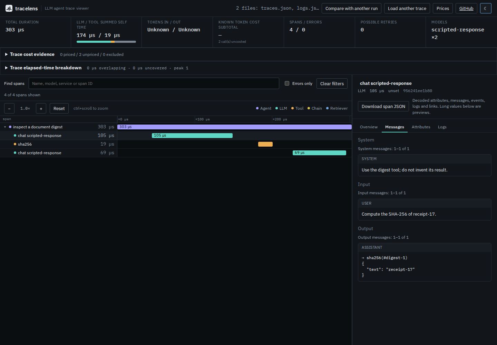

# Inspecting messages exported as OTLP logs

The Python OpenTelemetry GenAI helper's `EVENT_ONLY` mode exports conversation
content through a `LoggerProvider`, separately from trace spans. The
[helper documentation](https://github.com/open-telemetry/opentelemetry-python-contrib/blob/main/util/opentelemetry-util-genai/README.rst)
describes these capture modes. The [logs data model](https://opentelemetry.io/docs/specs/otel/logs/data-model/)
supplies trace/span context; the [GenAI details convention](https://github.com/open-telemetry/semantic-conventions-genai/blob/main/docs/gen-ai/client-inference.md)
defines the structured message attributes. Those conventions are still evolving.

At source `bbfbe4407fe8d9c32e0151fe979b1071b80dece9`, a combined export opened
four spans but displayed none of their messages. Selecting the trace and log
files together failed. The [baseline receipt](capture-event-only/baseline.json)
was produced by independently compiling that revision against the retained
SDK export.

| Actual SDK capture | Before | Current source |
| --- | --- | --- |
| Combined JSONL | 4 spans; log line skipped | 4 spans; 2 matched log records |
| Separate traces and logs | Import rejected | Both model turns inspectable |
| System, prompt, tool request/result, completion | Missing in event-only mode | SDK content preserved |
| Content exported to spans and logs | Span messages visible | Same transcript; no duplicate messages |
| Span counts, timing, errors and cost | Trace measurements | Same measurements |



## Open the capture

From this source checkout:

```sh
npm ci
npm run build
node dist-cli/cli/index.js logs studies/log-events/capture-event-only/traces.json studies/log-events/capture-event-only/logs.json --json
```

For the browser, run `npm run preview` and choose **Inspect messages from logs
(local SDK capture)**. Or select `traces.json` and `logs.json` together in the
file picker. Select the first `chat scripted-response` call and open Messages
to see the system instruction, prompt and tool arguments. The second call
contains the tool result and final scripted response. Logs shows the source
file and collection path; **Download span JSON** retains every original decoded
record field. Unmatched logs have a separate download in the warning panel.

```text
traces.json                         logs.json
  trace ID + span ID <-------------- same trace ID + span ID
  recorded call                     prompt / tool call / completion
          |
          +--> Messages: normalized conversation
          +--> Logs: decoded content and source location
          +--> span JSON: complete original decoded log record
```

## What ran

[`capture.py`](capture.py) uses `opentelemetry-util-genai 1.2b0`, SDK and OTLP
encoder `1.45.1`, and Protobuf `7.36.2`. It creates an agent span, two scripted
inference-shaped spans and a tool span that actually computes SHA-256 of
`receipt-17`. The conversation is **synthetic**; no model, provider API or
external service was called. Span timestamps, context IDs and log encoding
come from the real local SDK, not hand-built OTLP fixtures.

Each oracle is read directly from the SDK log objects before encoding. The
retained [event-only](capture-event-only/) and [span-and-event](capture-span-and-event/)
captures each contain four spans and two records. Their system/prompt/tool
content is checked against the parser and actual CLI output. The digest is
`3d9b849244959f3c63eab896d824a077a145676a6205fb17b3d23df3a3f560b6`.
Regeneration creates fresh IDs and timestamps, so its files will not be identical:

```sh
uv run --locked --script studies/log-events/capture.py /tmp/tracelens-event-only-new
uv run --locked --script studies/log-events/capture.py /tmp/tracelens-span-event-new --mode SPAN_AND_EVENT
```

Run the retained replay, optionally against a fresh installed package directory:

```sh
node studies/log-events/replay.mjs . /tmp/tracelens-log-replay.json
node studies/log-events/replay.mjs /path/to/node_modules/@antonsoloviev/tracelens /tmp/tracelens-installed-log-replay.json
node studies/log-events/browser.mjs /tmp/tracelens-log-browser
```

The replay checks all SDK message parts and original log records, file
provenance, combined JSONL physical lines, logs-only refusal, and existing
summary/tree/timing/cost commands. Measurement comparisons omit the explicitly
added message/log fields and file provenance. Browser replay uses actual local
file selection, then turns networking off before inspecting both calls and
downloading matched and unmatched evidence. It checks Chromium and Firefox at
1440px dark and 375px light, and byte-compares served assets to the build.

## Boundaries

- Correlation requires both IDs and one target. No similar-name, timestamp or
  nearest-call fallback is used. Duplicate span identities remain subject to
  the existing import rejection rules; an ambiguous unselected target is not
  assigned. Missing/all-zero/conflicting context remains unmatched.
- Span attributes take precedence over span events, which take precedence over
  logs, separately for input, output and system content. All log records stay
  inspectable even when their content does not win. Records are kept in import
  order without guessed deduplication or timestamp ordering.
- Only the current inference-details message attributes are normalized from
  logs. Other event names and arbitrary bodies stay evidence. The viewer does
  not infer calls, usage, errors or elapsed time from log metadata.
- Raw means the original **decoded JSON record**, including severity, flags
  and unknown extension fields. It is not an original-byte archive or complete
  OTLP schema validator. Keep the input files for wire-level analysis.
- Dropped attributes warn when reported. Malformed collections warn that their
  missing record count is unknown. Nothing can recover content never exported;
  logs alone cannot supply a missing trace. Browser input remains limited to
  32 files and 25 MiB combined, with bounded previews and full explicit downloads.

This is a source change. The npm release and hosted demo are unchanged.
