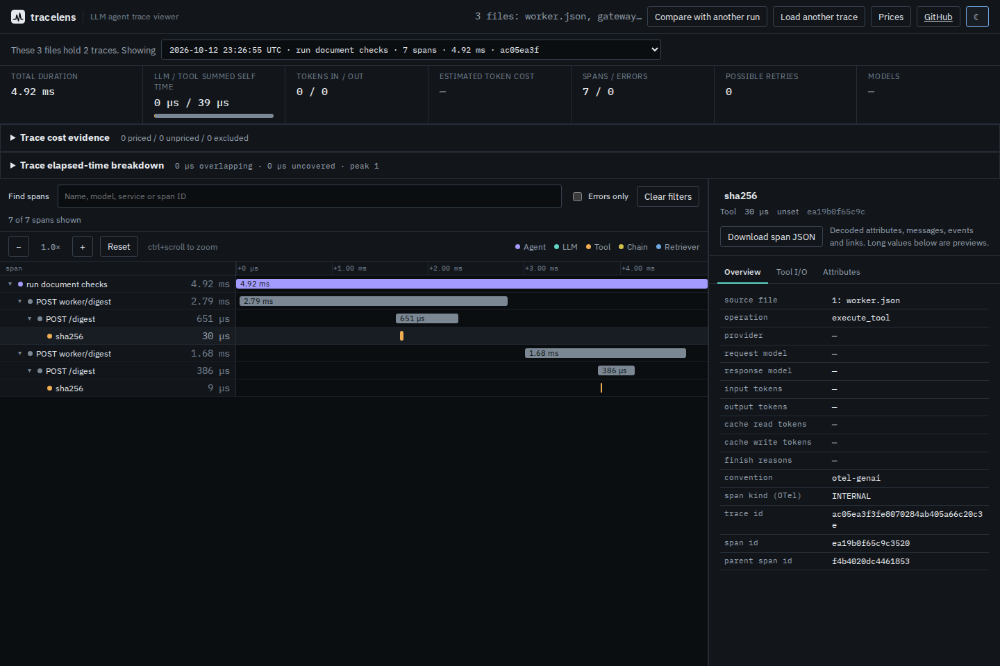

# Related service exports in one investigation

An agent's gateway, worker and queued consumer can export separate files. Opening
only the worker loses its gateway parents; opening only the consumer loses the
links back to the work it consumed. At source commit `c14341a`, dropping several
files into TraceLens silently read the first one, and the CLI rejected multiple
inspection paths.

The source build now decodes each selected file, combines spans by their complete
`(traceId, spanId)` identity, then selects a trace and resolves its parents and
links. Files can mix OTLP JSON, Collector-style OTLP JSONL and Jaeger JSON. Choose
or drop the complete group; this is a single import, not an incremental append.



## A captured workload, not hand-written span relationships

[`capture-multifile.py`](../../scripts/capture-multifile.py) uses OpenTelemetry
Python SDK 1.45.1 with three providers and a small file exporter. The gateway
makes two real loopback HTTP requests with injected W3C trace context. The worker
extracts that context, calculates SHA-256 digests of two synthetic strings and
queues the server span contexts. A separate audit trace links to those contexts
and writes the receipts to disk. No model or external service is called.

The SDK supplies identities, parent contexts and timestamps. Its Protobuf encoder
writes two JSONL exports and one JSON document, using base64 byte identities.
[`oracle.json`](fixtures/oracle.json) records SDK objects before encoding and
SHA-256 hashes of the three wire files. The replay checks every span's name,
identity, parent, nanosecond timestamps, service, attributes and link identities.
See the OpenTelemetry [tracing API](https://opentelemetry.io/docs/specs/otel/trace/api/)
for the span context and link model.

| Export | Recorded spans | Result opened alone | Result in the group |
| --- | ---: | --- | --- |
| `gateway.jsonl` | 3 | Gateway and two client calls | Same request trace as worker |
| `worker.json` | 4 | Two roots with missing-parent warnings | Four descendants of gateway calls |
| `audit.jsonl` | 2 | Both link targets absent | Both targets available in request trace |

The combined import contains two selectable traces: the seven-span request with
one root, and the two-span audit with one root. Neither has parser warnings.
Before, dropping worker, gateway and audit in that order displayed only four
spans. Both Chromium and Firefox now display seven, and the audit picker exposes
the other two. Links preserve relationships; they do not add ancestry, time or
cost to the audit trace.

## Try the source build

The npm 0.3.3 package and hosted demo are not updated by this source change.
From a checkout of this revision:

```sh
npm ci
npm run build
node dist-cli/cli/index.js tree studies/multifile/fixtures/worker.json studies/multifile/fixtures/gateway.jsonl studies/multifile/fixtures/audit.jsonl
```

Run `npm run preview` and drop those three files together, or use **Choose trace
files** to select them. The trace picker switches between request and audit.
Open the audit's Links panel to follow a `POST /digest` target in the other file.
The span overview and downloaded span JSON identify the source file.

Inspection commands `summary`, `tree`, `timing`, `cost` and `links` all accept
multiple paths. `--trace` selects from the whole group. For example:

```sh
node dist-cli/cli/index.js links studies/multifile/fixtures/worker.json studies/multifile/fixtures/gateway.jsonl studies/multifile/fixtures/audit.jsonl --trace 925d4acf --json
node dist-cli/cli/index.js compare --baseline-file studies/multifile/fixtures/gateway.jsonl --baseline-file studies/multifile/fixtures/worker.json --candidate-file studies/multifile/fixtures/gateway.jsonl --candidate-file studies/multifile/fixtures/worker.json --json
```

The second command compares the same captured request with itself: seven calls
on each side and zero wall-time change. For different runs, repeat the two file
flags with their respective exports. Do not mix group flags with positional
comparison paths. The existing `compare before.json after.json` syntax remains.

## Boundaries and retained evidence

- Up to 32 files per group; the browser also limits the combined bytes to 25 MB.
  The CLI has the file-count limit, but no byte limit. Files stay in browser
  memory; trace switching can reparse retained inputs in a worker.
- Any duplicate `(traceId, spanId)` in a group rejects the import, including
  identical retransmissions and duplicates in an unselected trace. The error
  identifies both file positions and names. There is no inferred deduplication
  or choice of a newer record. Export non-overlapping spans first.
- A file that cannot be decoded or has no valid spans rejects the group. Existing
  partial-import behavior remains: malformed individual spans and truncated
  final JSONL lines can be skipped with file-scoped warnings. An accepted group
  is not proof that the exporter recorded every span.
- Warnings are scoped to the selected trace when their trace identity is known;
  unscoped container warnings remain visible. Missing parents and link targets
  are still possible when the selected files are incomplete.
- File positions distinguish identical filenames. Provenance is import metadata,
  not authentication. It is retained in span/link JSON and comparison call
  evidence; timing and cost reports continue to identify spans by ID.
- Single-file parsing retains its existing behavior. Multi-file grouping does
  not synchronize clocks, infer causality, correlate runs, or recover lost data.
- A failed, canceled or timed-out replacement preserves the previous comparison.
  Choosing another group replaces the whole candidate.

[`before.json`](before.json) and [`after.json`](after.json) retain core and CLI
observations. [`browser-before.json`](browser-before.json) and
[`browser-after.json`](browser-after.json) retain four workflows each: Chromium
and Firefox at 1440px dark and 375px light. Each workflow byte-checks 24 served
assets and stops its web server before importing. The after workflows download
span/link/comparison evidence, navigate an audit link by keyboard, reject a
bad or duplicate candidate without changing the prior report, and recover with
a new file selection. All four after workflows have no page/CSP errors, late
network requests, horizontal page overflow or settled-state axe violations.

An initial baseline accessibility check sampled an entrance animation mid-frame;
waiting for animation completion removed the transient contrast report. No color
change was made. Both retained before and after observations inspect settled
rendering. The mobile waterfall scrolls horizontally within its own pane.

To repeat the core and browser observations after building:

```sh
node studies/multifile/replay.mjs --output /tmp/tracelens-multifile-replay.json
node studies/multifile/browser.mjs --build dist --output /tmp/tracelens-multifile-browser --after
```

To make a new capture (new IDs and timings are expected):

```sh
uv run --locked --script scripts/capture-multifile.py --output-directory /tmp/tracelens-new-capture
```

The replay deliberately uses the committed fixtures for reproducible comparisons;
it does not replace them with a fresh capture automatically.

[`scale.mjs`](scale.mjs) distributes 500 synthetic repetitions of the capture,
with remapped trace IDs, over the maximum 32 files. It checks 4,500 spans across
1,000 traces and a correctly assembled seven-span selection. The retained
[`scale.json`](scale.json) measured a 143.8 ms median over five warm parses of
3,697,608 input bytes on Node 26.7.0, 14-vCPU WSL2 Linux, 48 GB RAM. This is a
parser measurement, not a browser latency guarantee. Run
`node studies/multifile/scale.mjs --output /tmp/tracelens-multifile-scale.json`
to measure the current environment.

## Clean build and installed CLI

The [verification receipt](verification.json) covers implementation `b39b55c`.
A fresh archive preserved all 478 tracked files. On Node 24.21.0, installation,
lint, types, 379 unit checks in each of two locales, 30 CLI checks, 128 browser
checks and the existing browser workflow passed. The unit runs used two workers;
no timing threshold was changed. All 33 clean web-build files matched the tested
checkout, including the 24 assets fetched by each offline workflow.

The local 52,644-byte npm tarball was separately installed and executed on
Node 20.0.0 and 24.21.0. All 26 compiled files matched the clean build; the SDK
replay and grouped comparisons succeeded through the installed executable.
The source/package version remains 0.3.3. This receipt describes a local packed
artifact, not a new registry release or hosted deployment.
