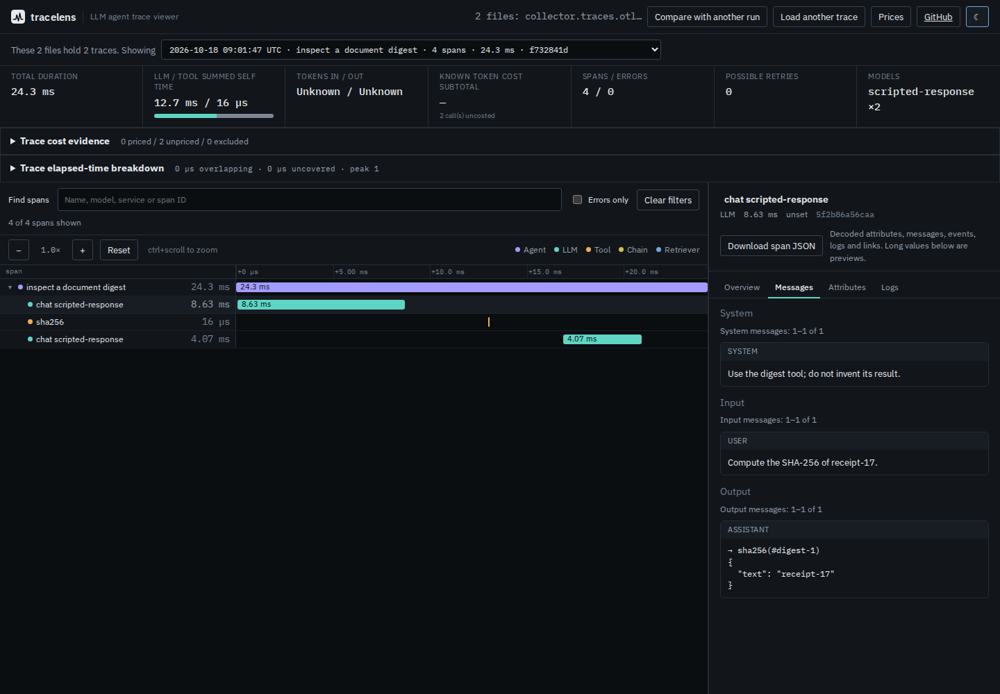

# Native OTLP requests and Collector protobuf files

The baseline `411b2e5` accepts JSON exports but rejects native protobuf files as
non-text. A user who retained an SDK's HTTP body or enabled `format: proto` in
the Collector had to convert it elsewhere before opening TraceLens.

The source CLI and browser now read both carriers directly. The retained local
capture contains six actual SDK spans, two correlated logs and a cross-trace
link. Its conversation is scripted; only the document digest is computed. No
model, credentials or external service was used.



[Phone view](../../docs/assets/otlp-binary/firefox-375.png). Both engines and both
widths were opened and inspected: the native message and tool-call text remains
readable, and missing token counts remain unknown.

## Explicit carriers

Protobuf has no embedded signal discriminator. A raw OTLP request also differs
from a Collector file's sequence of length-prefixed batches. TraceLens requires
that context rather than guessing after a failed text parse.

| Name ending | Signal | Encoded message | Carrier |
| --- | --- | --- | --- |
| `.traces.pb` | Traces | ExportTraceServiceRequest | One raw OTLP/HTTP body |
| `.logs.pb` | Logs | ExportLogsServiceRequest | One raw OTLP/HTTP body |
| `.traces.otlp` | Traces | Trace batches | Collector four-byte big-endian length prefixes |
| `.logs.otlp` | Logs | Log batches | Collector four-byte big-endian length prefixes |

Bare `traces.pb` and `logs.otlp` are accepted too. A generic `capture.pb` asks for
an explicit name. Library callers can supply `{ signal: 'traces', framing:
'raw' }` to `decodeTraceFile` for a differently named body. The extension is a
caller declaration, not authentication of the file's provenance or signal.

The Collector's [documented file format](https://github.com/open-telemetry/opentelemetry-collector-contrib/blob/main/exporter/fileexporter/README.md#file-format)
uses a four-byte big-endian unsigned message size. Raw request bodies follow
[OTLP/HTTP binary Protobuf encoding](https://opentelemetry.io/docs/specs/otlp/#otlphttp).
Compressed carriers, gRPC message frames, metrics, profiles and custom encoders
are outside this addition.

## Try the retained capture

From a source checkout:

```sh
npm ci && npm run build
node dist-cli/cli/index.js logs studies/otlp-binary/fixtures/collector.traces.otlp studies/otlp-binary/fixtures/collector.logs.otlp --json
node dist-cli/cli/index.js tree studies/otlp-binary/fixtures/collector.traces.otlp
```

The tree opens the four-span digest workflow and lists the other two-span trace.
Use its displayed `--trace` value to inspect the linked consumer. The log report
contains two matched records; it does not manufacture span events, token usage
or an event timestamp from them.

In the browser, select the two `collector.*.otlp` files together, or select all
eight `http-*.pb` bodies together. Import works with the network disconnected
after loading the page. The existing message, log, attribute, link, timing and
comparison workflows remain available. Both import forms normalize to the same
observations as the native Collector JSON controls.

## Native producer and independent observations

[`capture.py`](capture.py) runs OpenTelemetry Python 1.45.1 with the GenAI helper
1.2b0 and its real OTLP/HTTP exporters. A recording loopback proxy forwards their
unaltered bodies to **Collector 0.163.1**, which writes JSONL and uncompressed
`format: proto` files in parallel. Its core distribution includes the file
exporter; no external telemetry endpoint is used.

```text
SDK spans/logs -- raw protobuf --> loopback recorder --> Collector
                        |                              |      |
                        v                              v      v
                 retained HTTP bodies             JSONL   framed protobuf
                                                  control      |
                        +--------------------------------------+
                        |
                        v
                 wire-boundary check --> schema decoder --> existing viewer
```

The [capture oracle](fixtures/oracle.json) records package versions, the native
binary hash, exact input hashes and the SDK objects' IDs, names, clocks, typed
attributes and links before encoding. Unsafe source integers are explicitly
recorded as decimal strings with original Python types, avoiding a rounded JSON
oracle. Actual IDs and timestamps vary on recapture; no byte-determinism claim
is made.

The logs have an observed timestamp but **no event timestamp**. Both absence and
the independently retained observed time survive import and downloads. Signed
int64 extrema stay exact strings; false and zero stay their original values.
The declared model is `scripted-response`; no provider rate or measured token
counter is invented for it.

The [schema receipt](../../scripts/otlp-schemas.json) pins six generated modules
to the official `opentelemetry-proto` 1.45.1 descriptors and `protoc-gen-es`
2.16.0. The only runtime dependency added is `@bufbuild/protobuf` 2.16.0.
Ordinary builds use committed schemas; regeneration is explicit:

```sh
npm run generate:otlp
```

Licenses and source attribution are in [the third-party notices](../../THIRD_PARTY_NOTICES.md),
with copies included in browser builds.

## Malformed wire data must not become measurements

Eleven [constructed protocol controls](controls/oracle.json) are explicitly
separate from the native capture. Google's Protobuf runtime independently
checks them. Valid controls include Unicode names, opaque bytes, open-enum
values, merged repeated fields and native oneof last-member semantics.
Truncation, illegal tags and invalid UTF-8 are refused.

Two controls exposed a semantic-runtime boundary gap:

| Constructed wire input | Google decoder | Direct Protobuf-ES 2.16.0 | Guarded import |
| --- | --- | --- | --- |
| ResourceSpans length one byte too short, complete underlying payload | Refused | Returned a span | Refused |
| Unknown length-delimited field with size 2^32 | Refused | Accepted after truncating the length | Refused |

The [direct comparison](runtime-boundaries.json) and
[`check-boundaries.mjs`](check-boundaries.mjs) retain both results. The import
check bounds every child message to its declared byte extent, checks uint32
lengths and declared wire types, then leaves value interpretation to the
schema runtime. No partially decoded batches are returned on failure. The
browser retains an existing comparison and can recover with a valid replacement.
This is an importer policy for the bundled OTLP schema, not a claim of complete
Protobuf conformance or a report about an upstream security advisory.

```sh
uv run studies/otlp-binary/controls.py --out /tmp/otlp-controls
node studies/otlp-binary/check-boundaries.mjs /tmp/wire-boundaries.json
```

The [browser receipt](results/browser.json) records ten passing Chromium/Firefox
workflows, with eight native import/navigation contexts at 1440px and 375px.
Each validates actual downloads, complete identities, exact clocks and attributes,
missing event times, offline cross-trace navigation, accessibility and overflow.
Two further cases retain a comparison after a corrupt binary replacement and
successfully retry. These are local production-build checks; the separate hosted checks below use the canonical public URL.

## Limits

- Binary files are limited to 25 MiB, 100,000 batches, 64 nested message/group
  levels, one million wire records and 26,214,400 decoded UTF-16 units. Span
  ancestry is a flat ID graph and does not consume message-nesting depth.
- Known fields must use their declared wire types. Unknown fields warn and are
  absent from the decoded JSON view; retain the original binary to inspect them.
- The JSON download is decoded evidence, not a binary archive. Joined resource
  batches do not acquire invented physical source-line numbers.
- A file cut exactly between complete batches cannot reveal omitted later
  batches. No missing spans, duration, event times or outcomes are reconstructed.
- Existing per-file identity, correlation, status and usage rules still apply.
  Duplicate identities across related files refuse the whole group.
- Source, a locally packed CLI and the public demo contain the addition. Package
  metadata remains 0.3.3; no npm registry release accompanies it.

## Clean builds and publication

The clean archive at `3dff071` was installed and built on Node 24.21.0. Lint,
types, all 585 unit checks and all 32 CLI integrations pass. An initial full
browser run passed 149 cases and failed seven: six exceeded the existing
30-second accessibility budget, and one selected a span while the current
trace was being reloaded. All seven pass in an isolated ten-case rerun, using
one worker and a 120-second overall budget with the original assertions.
The unit parsing deadline also initially failed under host contention; isolated
baseline and corrected checks, and the subsequent complete unit run, pass.
No product deadline or assertion was weakened.

A non-editable local package repeats the original SDK observations, 24 CLI
operations and four binary-versus-native-JSON comparisons on both
[Node 20.0.0](results/installed-node20.json) and
[Node 24.21.0](results/installed-node24.json). All available comparison deltas
are zero. The [package receipt](results/package.json) verifies all 39 compiled
files and the third-party license copies against the clean build. This is a
packed-artifact check, not an npm release.

Source commits `8234ad7`, `3dff071` and `c999afc` were pushed to main. Static
deployment `c5437af` adds the native importer while retaining all previous
hashed assets. The [canonical byte check](results/hosted-bytes.json) compares
every file in the clean production build with its normal public URL; it does
not establish other hosted files or registry contents.

The [public browser receipt](results/hosted-browser.json) records all ten native
workflows passing on `https://antonsoo.github.io/tracelens/` in Chromium and
Firefox, at desktop and phone widths. It repeats first import while offline,
exact evidence downloads, cross-trace navigation and recovery after a corrupt
comparison replacement. All 36 canonical build files match their captured
production hashes. No npm registry release is established by these checks.
