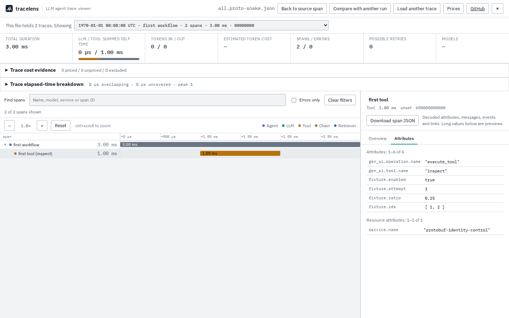

# Keeping byte identities through Protobuf JSON

`034732b` lowercased every ID. That works for OTLP's hexadecimal IDs, but
Protobuf's ordinary `MessageToJson` serializer writes bytes as case-sensitive
base64. These two different SDK span IDs collided:

| Span's eight bytes, in hex | Protobuf JSON |
| --- | --- |
| `0000000000000001` | `AAAAAAAAAAE=` |
| `6800000000000001` | `aAAAAAAAAAE=` |

The file was rejected as duplicate spans. With similarly chosen trace IDs and
different span IDs, two separate traces were silently grouped as one. The
serializer's `preserving_proto_field_name=True` option exposed another gap:
span fields were accepted, but typed attributes such as `string_value` were
decoded as null. A recorded tool became an unclassified span.

`ea52025` decodes recognized byte IDs before trace grouping, parent joining,
link resolution and selection. It also reads original `AnyValue` field names
recursively. Complete parsed traces now agree with the corresponding OTLP JSON
form, including tool classification, typed attributes, parents, links and
timing. This is an unreleased source change; npm remains at 0.3.3.

## Producer and expectations

[`capture.py`](capture.py) runs OpenTelemetry Python SDK **1.45.1**, its actual
`encode_spans` exporter and Protobuf **7.36.2**'s `MessageToJson`. Four SDK spans
form two workflows, with two cross-trace links. IDs and nanosecond timestamps
are deliberately fixed fixture values, not observed production traffic. No
provider requests or model calls occur.

The [oracle](fixtures/oracle.json) reads IDs, parents, links, names and timestamps
directly from the SDK objects **before serialization**. Nine files cover all
spans, the span-collision pair and the trace-collision pair, each as ordinary
Protobuf JSON, original-name Protobuf JSON and hexadecimal OTLP JSON. The
hexadecimal control uses an explicit byte conversion and numeric enums.

The relevant contracts are the [OTLP JSON deviations](https://opentelemetry.io/docs/specs/otlp/#json-protobuf-encoding)
and [Protobuf JSON byte/field-name mapping](https://protobuf.dev/programming-guides/json/),
checked 2026-10-10. Protobuf JSON and strict OTLP JSON are different encodings;
accepting both in this viewer does not make a base64 document a valid OTLP/HTTP request.

## What was exercised

[`verify.mjs`](verify.mjs) checks default trace identities against SDK objects,
selection by hexadecimal and complete base64 IDs, complete parsed objects
against the OTLP control, and actual CLI links/timing/cost JSON reports.
The [before run](before.json) passes **23/84** outcomes; the [source run](after.json)
passes **84/84**. This includes new base64-selector support, so the counts are
coverage of specified workflows, not a production failure rate.

The [existing-corpus comparison](corpus.json) keeps **22/22** file outcomes
unchanged: 27 selected traces and 127 spans across the existing examples and
instrumentation fixtures; the metadata-only file is still rejected. It compares
complete parsed values and warnings for every trace in each accepted file.

The production browser checks run all three formats in Chromium and Firefox:
upload, choose the second trace, download its links, go offline, follow a link
back into the first trace, download the target span and return to the source.
Both trace and span IDs match the SDK's bytes. Boolean, integer, decimal and
array attributes survive, and the tool keeps its classification. Retained
downloads: [Chromium](browser-chromium.json), [Firefox](browser-firefox.json).



[Chromium at 375px](../../docs/assets/protobuf-identities/chromium-375.png),
[Firefox at 1440px](../../docs/assets/protobuf-identities/firefox-1440.png),
[Firefox at 375px](../../docs/assets/protobuf-identities/firefox-375.png).
All four final screenshots were opened and inspected; mobile captures include
the complete attribute panel below the waterfall.

The [clean-build and package record](checks.json) lists versions, commands,
asset hashes and installed-package replays. Both the [Node 20.0.0](installed-node20.json)
and [Node 26.7.0](installed-node26.json) installs pass all 84 outcomes; their
25 installed code files match the checked clean build byte for byte. The
original fixtures remain synthetic SDK serialization controls even though
their serializer is real. Failed CLI diagnostics replace the machine-specific
fixture directory with `fixtures`; the failure message is otherwise retained.

The first complete browser run passed 107/108 cases, with a Chromium keyboard
file-picker timeout in an existing test. Three isolated repeats passed without
changes. A second whole run passed 107/108, but lost its Firefox page around a
simulated clock jump in the parser-timeout check. The captured trace was inspected;
neither intermittent failure's cause is established.

`1bf4090` changes that timeout check to wait for the actual 30-second watchdog,
verify it does not fire early, preserve the prior comparison and retry an import.
The final whole run passed **108/108**, without skips or retries. The two real
watchdog observations were **30.282 s** (Chromium) and **31.032 s** (Firefox),
measured from file selection to a visible error. The check record retains both
earlier failures. The source build also passed 244 core checks, 30 CLI checks,
lint and both typechecks.

## Reproduce

From the repository root:

```sh
npm ci
npm run build
node studies/protobuf-identities/verify.mjs --dist dist-cli --output /tmp/protobuf-check.json
```

Regenerate the SDK files with pinned direct dependencies:

```sh
uv run studies/protobuf-identities/capture.py --output studies/protobuf-identities/fixtures
```

Build `034732b` in a separate checkout and pass its `dist-cli` to the verifier
with `--observe-only` to retain the old failures. Compare existing files with:

```sh
node studies/protobuf-identities/compare-corpus.mjs \
  --before /path/to/old/dist-cli --current dist-cli --output /tmp/corpus-check.json
npx playwright test tests/browser/protobuf-identities.spec.mjs
```

## Boundaries

Canonical standard and URL-safe base64, padded or unpadded, are recognized at
the correct byte widths. Unknown strings remain opaque and case-sensitive;
this does not validate every OTLP field or reject every malformed identifier.
Hex IDs remain case-insensitive. Trace selection supports complete base64 IDs
and hexadecimal prefixes; base64 prefixes are not decoded.

This fixes identity and attribute transport. It does not infer missing spans,
causal execution order, model usage or costs. Existing omission counts,
unresolved links and timing/cost limitations still apply.
