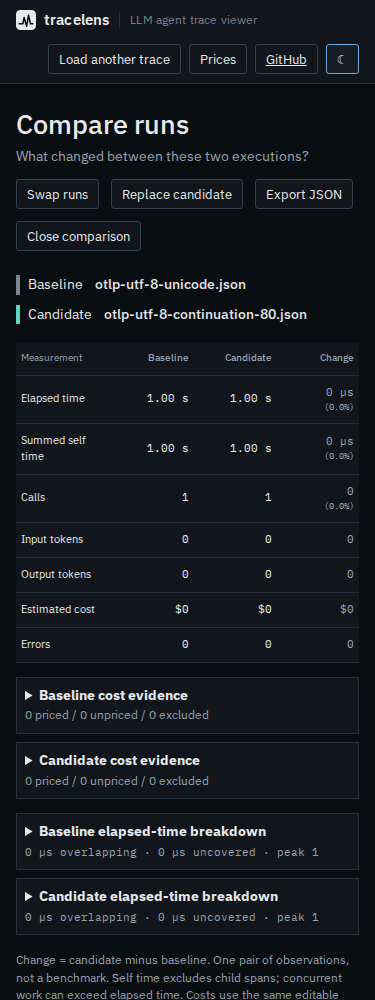
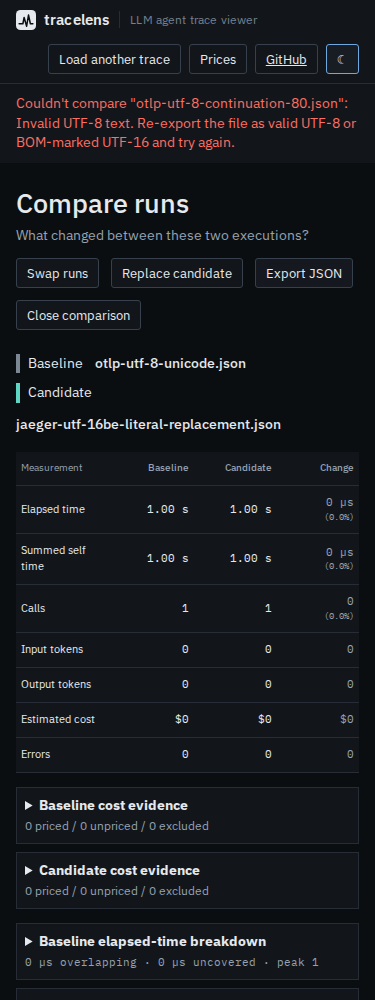

# Reject damaged text before comparing trace evidence

At baseline `bea26a80aeadbca3659c493a7378597582c0f410`, TraceLens used the
default replacement mode of `TextDecoder`. Two otherwise identical OTLP files
with raw byte `80` versus `81` (hex) in an operation name both became
`operation U+FFFD`. The CLI comparison exited successfully, marked the operation
as matched and emitted no warnings. The original files had different bytes;
neither was valid UTF-8.

Production correction: `e0aa138c8b45defe4c2fdbff57bd4002fd11562c`.
The shared decoder now uses fatal decoding and reports an encoding-specific
error asking for a valid UTF-8 or BOM-marked UTF-16 export. This applies to
trace files, browser worker imports and CLI price files. An invalid browser
candidate keeps the previous comparison and its downloadable report intact.

The [WHATWG Encoding Standard](https://encoding.spec.whatwg.org/#dom-textdecoder-decode)
defines fatal decoding as an error instead of replacement on malformed input.
The change does not reject a correctly encoded literal U+FFFD, Unicode
noncharacters or JSON's escaped surrogate notation. It does not try to infer
legacy encodings or reconstruct text that was already replaced upstream.

## Reproduced byte-level behavior

[`generate.py`](generate.py) builds labeled **synthetic** OTLP JSON, collector
JSON Lines, Jaeger JSON and price-table inputs. Python's independent strict
UTF-8 / UTF-16LE / UTF-16BE decoders establish which bytes are valid. The
[`cases.json`](cases.json) manifest retains exact Base64 bytes, SHA-256 hashes
and decoded text for valid cases.

Each format has eight valid cases: Unicode text and a literal replacement
character in UTF-8, UTF-8 with BOM, and both UTF-16 byte orders with BOM.
Fourteen damaged cases cover stray continuation bytes, overlong sequences,
encoded surrogates, values beyond Unicode, incomplete sequences, invalid
leading bytes, a damaged BOM-marked payload, unpaired UTF-16 surrogates and
odd UTF-16 byte counts.

| CLI outcome | Before | Corrected |
| --- | ---: | ---: |
| Valid inputs accepted intact | 32/32 | 32/32 |
| Damaged inputs rejected with an encoding error | 0/56 | 56/56 |
| All expected outcomes | 32/88 | 88/88 |

Before the fix, 50 damaged inputs were accepted; the other six failed later
with JSON errors. The original two-damaged-name comparison is retained in
[`cli-before.json`](cli-before.json): a matched operation, no warnings and exit
0. [`cli-after.json`](cli-after.json) records exit 1 and empty JSON stdout.
The replay checks both actual process status and report content.

[`compatibility.json`](compatibility.json) compares complete stdout and stderr
for `summary`, `tree`, `timing`, `cost`, `links` and self-comparison on all nine
committed example traces. All 54 outputs are unchanged. These examples mix
synthetic and recorded captures; their provenance is in
[`examples/README.md`](../../examples/README.md). This check is not an estimate
of how often damaged encodings occur in real exports.

## Browser imports and recovery

[`browser.mjs`](browser.mjs) serves the built app, verifies its fetched bytes,
loads the bundled fonts, stops the server and puts the browser offline.
Through the actual file inputs it loads a baseline, opens comparison and
replaces the candidate with each of the 66 trace fixtures. Each input is
followed by a real comparison JSON download. A failed candidate must leave
that complete report identical to its predecessor.

| Production browser / viewport | Before | Corrected |
| --- | ---: | ---: |
| Chromium / 1440 px | 24/66 | 66/66 |
| Chromium / 375 px | 24/66 | 66/66 |
| Firefox / 1440 px | 24/66 | 66/66 |
| Firefox / 375 px | 24/66 | 66/66 |

The final recovery uses valid UTF-16BE containing accented Latin, Japanese and
an emoji. All four corrected runs recover the exact operation name. The
88 CLI cases additionally cover the price-file path, which has no browser
file-import counterpart. Both browser runs use Chromium 153.0.8010.12 and
Firefox 155.0 on WSL2 Linux.

Receipts: [`before/browser.json`](before/browser.json),
[`after/browser.json`](after/browser.json). All 24 fetched assets per context
match the corresponding build, with no page errors, CSP violations,
post-shutdown HTTP requests or horizontal overflow. All eight screenshots were
inspected. The phone error wraps readably and the previous candidate remains
named under the comparison; lower sections scroll within the existing app.




## Reproduction

Build the checkout with `npm ci && npm run build`. With Playwright's Chromium
and Firefox installed:

```sh
python studies/text-integrity/generate.py
node studies/text-integrity/replay.mjs dist-cli/cli/index.js replay-tmp replay.json
node studies/text-integrity/browser.mjs dist browser-replay
```

For the old behavior, build a separate archive of baseline commit
`bea26a80aeadbca3659c493a7378597582c0f410`. Point the same drivers at its CLI
and `dist` directory, adding `--baseline` to retain the failures without
asserting corrected behavior. `compatibility.mjs` accepts the old and new CLI
paths, the current checkout root, and an output receipt path.

[`build.json`](build.json) records all 59 tested web/CLI build files, totaling
795,678 bytes, matched byte for byte to a clean locked Node 24.21.0 archive
build of the production commit. The clean install passes lint, strict
typechecking, 370 unit tests, 30 CLI tests, the browser smoke scripts and 122
Playwright scenarios. [`verification.json`](verification.json) records these
checks and the packed artifact's files.

The 51,053-byte npm tarball has SHA-256
`e79dc05379216cb3894dc69091e1677dcf9d048a04535114d699efa20f6c7f23`.
All 29 files match both the clean archive and a separate offline installation.
The installed CLI passes all 88 byte-level cases and all 54 unchanged-output
comparisons on Node 20.0.0 and 24.21.0. The installed executable also reports its
version and rejects the original damaged comparison with empty JSON stdout.
Receipts: [`installed-node20.json`](installed-node20.json),
[`installed-node24.json`](installed-node24.json),
[`compatibility-node20.json`](compatibility-node20.json),
[`compatibility-node24.json`](compatibility-node24.json).

Package version 0.3.3 is unchanged. The
correction and evidence are source work; no package release or hosted
deployment is included.
