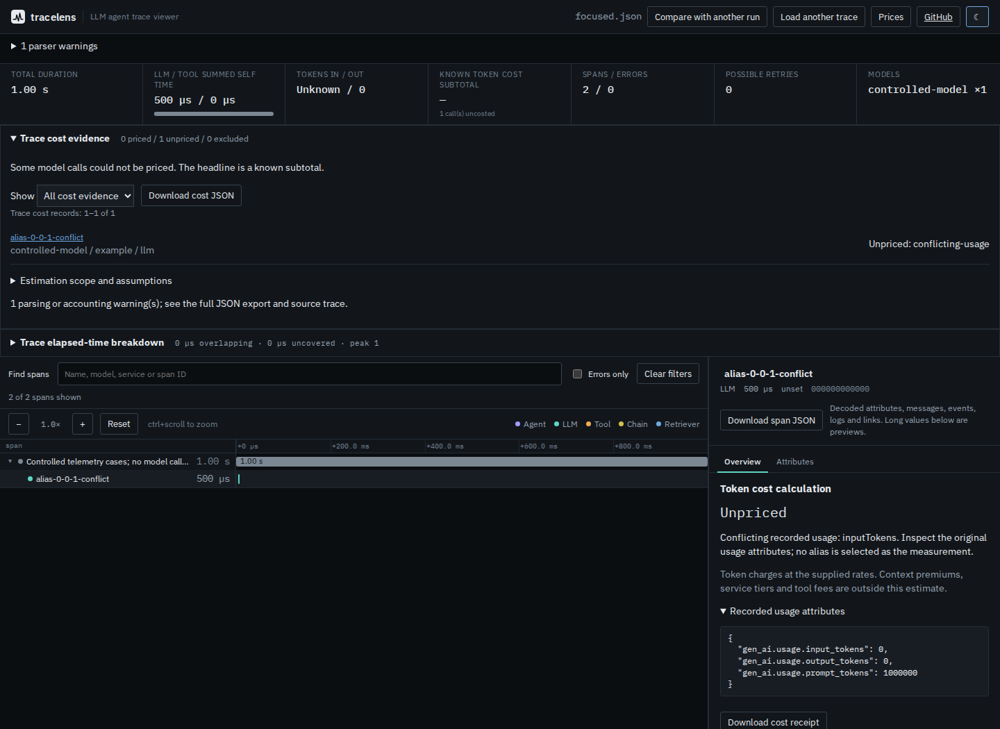

# When usage aliases disagree

At baseline `ec264582888bb44dd446865c72e67f306c2c6f91`, a span containing
`gen_ai.usage.input_tokens: 0` and legacy `gen_ai.usage.prompt_tokens: 1000000`
was priced as a complete zero-dollar call. Both values were retained in raw
attributes, but normalization selected the first recognized alias. Across
conventions, a later convention could replace an earlier invalid count.

The correction keeps each disputed quantity unknown, exposes
`usage.conflictingFields`, and emits a warning scoped to the span. Original
attributes stay intact. Equal repetitions count once, including zero. Invalid
sources cannot disappear behind a valid alias. The span inventory remains
complete: these are conflicting measurements, not missing spans.

| Controlled case | Baseline | Corrected source |
|---|---|---|
| Input aliases 0 and 1,000,000 | Complete $0 estimate | Unknown input; unpriced `conflicting-usage` |
| Agreed input/output zero | Complete $0 estimate | Complete $0 estimate |
| Reasoning aliases 0 and 1,000,000; inclusive output 1,000,000 | Selected reasoning zero; $1 | Reasoning unknown; inclusive output still supports $1 |
| Input zero plus invalid legacy count | Complete $0 estimate | Input unknown; unpriced `invalid-usage` |

Rates here are explicitly constructed user assumptions: $1 per million input
and output tokens, $0 cache reads, $2 cache writes. They are not vendor prices.
No provider was called and no invoice, production frequency or latency is claimed.



## Native serialization and replay

[`capture/capture.mjs`](capture/capture.mjs) uses pinned OpenTelemetry JS
`@opentelemetry/api` 1.9.0, `sdk-trace-base` 2.12.0 and `otlp-transformer`
0.223.0. The native tracer emits 62 controlled cases and one parent; the
native OTLP JSON serializer writes [the export](fixtures/native.json).
IDs, timestamps, model names and counts are constructed. No SDK attributes,
events or links were dropped. The [capture ledger](fixtures/capture.json)
retains versions, original attributes, expectations and the export hash.

The cases cover 19 pairs of already-supported alias spellings with agreement
controls, eight pairs across conventions, a three-convention disagreement,
invalid earlier/secondary sources, legacy-only input and true zero. These
cases were selected to exercise this defect and are not a general accuracy
benchmark. The primary [OpenTelemetry attribute registry](https://opentelemetry.io/docs/specs/semconv/registry/attributes/gen-ai/)
documents `prompt_tokens` and `completion_tokens` as replaced by inclusive
`input_tokens` and `output_tokens`; it does not establish that a newer spelling
is the correct observation when an export contradicts itself. Nonstandard
aliases retain the existing [documented dialect meanings](../../docs/formats.md).

The [built-artifact replay](replay.mjs) checks original attributes without
rewriting them and invokes actual `cost` and `compare` CLI commands.
[Before](results/before.json) matched 31 of 62 selected expectations;
[after](results/after.json) matched all 62. Priced/unpriced calls changed
from 60/2 to 39/23. Some reasoning conflicts still permit a charge because
reasoning is already inside the agreed output counter. A separate total is
also not a billing operand. Neither quantity is silently made valid.

The baseline's [fixed tracked JSON/JSONL list](baseline-files.json) contains
342 retained files, including metadata and deliberately invalid inputs.
Both artifacts parsed 65 and rejected 277. Input hashes, normalized trace
and summary hashes, and rejection messages are identical across this list;
none gained a conflict. [Comparison receipt](results/retained-inputs.json).
This is compatibility over retained files, not 342 independent traces.
The historical full instrumentation census was not rerun.

## Offline browser receipts

[`browser.mjs`](browser.mjs) loads each production build in Chromium and
Firefox at 1440 pixels in dark mode and 375 pixels in light mode. It
disconnects before the first file import, then imports four native SDK
exports through the real worker and downloads each full ledger and selected
receipt. All 32 downloads per revision equal their corresponding built CLI
reports. Raw contradictory counts remain inspectable. True zero and the
supported reasoning-only charge remain priced after the ambiguous case.

[Before results](results/browser-before.json) and [after results](results/browser-after.json)
retain the startup assets, receipts, warnings and download hashes. All eight
screenshots were inspected, including [before desktop](../../docs/assets/usage-conflicts/before/chromium-1440.png),
[before phone](../../docs/assets/usage-conflicts/before/chromium-375.png),
[after phone](../../docs/assets/usage-conflicts/after/chromium-375.png) and
the corresponding Firefox captures. No page errors, CSP violations,
external requests, requests after disconnection, horizontal page overflow
or axe violations were observed in these four contexts per build.

## Reproduce

```bash
cd studies/usage-conflicts/capture
npm ci
node capture.mjs
cd ../../..
npm ci
npm run build
node studies/usage-conflicts/replay.mjs . /tmp/usage-after.json after
node studies/usage-conflicts/browser.mjs . /tmp/usage-browser after
```

For the original behavior, archive baseline `ec264582`, install and build it
separately, then pass that artifact directory to the two current replay
scripts with mode `before`. The current study fixtures remain the common
inputs; the old source does not contain them.

## Limits and publication

This is reconciliation of recognized aliases on a single span. It does not
deduplicate separate instrumentation spans, infer which contradictory source
is correct, reconcile unrelated quantities, or convert providers that report
fresh input separately into inclusive input. Model and provider metadata keep
their existing precedence. An invalid alias takes diagnostic priority over
conflicts within the same spelling group; the original values still remain.
Absent optional cache counts retain the disclosed zero assumption; ambiguous
cache counts cannot use it. Price matching can independently prevent a charge.

The package version remains 0.3.3. Local source/browser receipts do not
establish an npm release or hosted deployment. Publication verification is
recorded separately after those artifacts are checked.

The [clean archive receipt](results/clean-checks.json) records Node 24.21.0
installation, lint, type checks, 564 unit assertions, the same 564 in a
comma-decimal locale, 32 CLI integrations, 146 broader browser scenarios and
this study's four offline contexts/32 downloads. The initial unbounded unit
run exceeded the existing 1,000 ms assertion for 20,001 spans (1,253 ms);
all 563 other assertions passed. The full suite passed with two workers,
then the default suite passed in the comma-decimal locale. The threshold
was unchanged. Direct isolated checks of that sample took 252-312 ms on
the baseline and 252-345 ms on the corrected artifact (six runs each,
14 vCPU WSL2, 48 GB RAM); these ranges do not establish a speed difference.

The [installed-artifact receipt](results/installed.json) records a fresh
60,912-byte local tarball installed on Node 20.0.0 and 24.21.0. All 31
runtime files equal the clean build. Each installed executable reproduced
all 62 selected cases and the 342 retained-file outcomes. A separate fresh
native SDK installation reserialized all six JSON fixture files byte for
byte; its capture ledger differs in its recorded Node version.

The pushed [public-source receipt](results/public-source.json) verifies 16
pinned files at `7e65ba8868a1636159d46baf244795f9022b9366`, with clean local
and remote main equality at capture. The clean build from `acf6f92` was
published by fast-forwarding `gh-pages` to `570e576`; later source commits
add documentation/receipts. The [canonical HTTP check](results/hosted-bytes.json)
matched all 34 build files, root before/after, and explicit `index.html`.
The [hosted browser replay](results/hosted-browser.json) passed all four
contexts and 32 downloads after disconnection before the first input.
Its [four screenshots](results/hosted-screenshots.json) are byte-identical
to the inspected clean-build captures. These checks do not establish an
npm release or a remote CI result; version 0.3.3 is unchanged.
